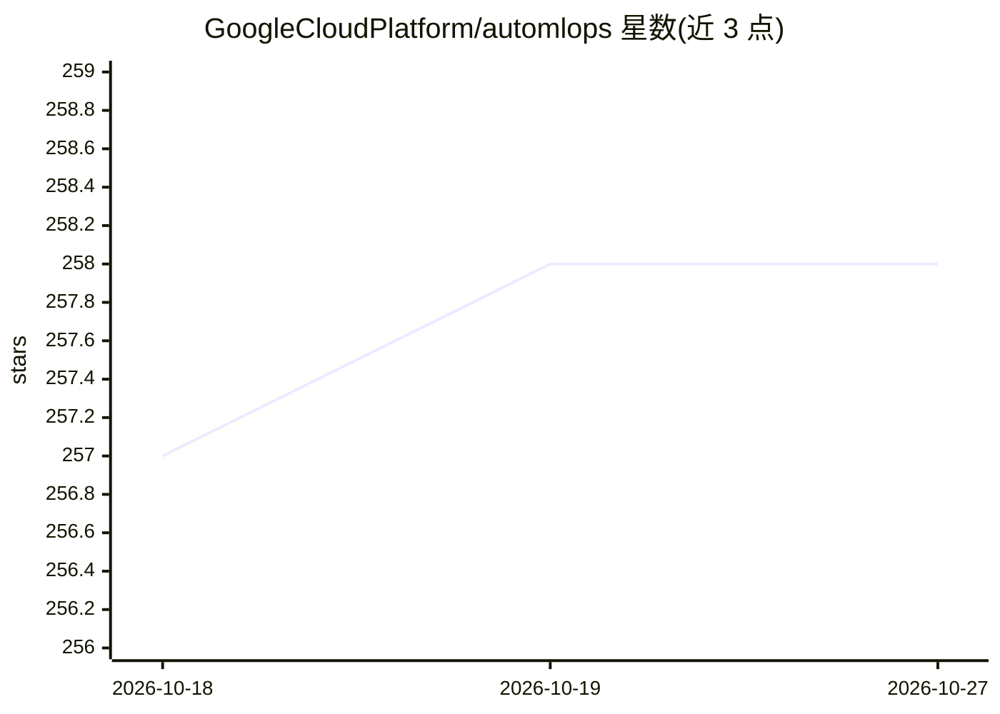

# GoogleCloudPlatform/automlops

⭐ 258 · Python · Apache-2.0 · 推送 2026-06-10 · [GitHub](https://github.com/GoogleCloudPlatform/automlops) · 组织维护

**生成并部署 GCP 上 CI/CD 集成 MLOps 流水线的 Python 框架**

AutoMLOps 是 Google Cloud Platform 组织下的 MLOps 流水线生成与运维工具：通过 @component/@pipeline 装饰器定义流水线，generate() 生成容器化代码库，provision()/deprovision() 以 gcloud 或 Terraform 进行基础设施即代码管理，deploy() 构建镜像并触发流水线，monitor() 对已部署端点创建模型监控作业，支持按周期或异常检测自动重训。面向在 GCP 上落地实验的数据科学家与 MLOps 工程师；默认深度绑定 Google Cloud 服务（Vertex AI Pipelines、Cloud Build、Artifact Registry 等），支持 Python 3.7-3.10。

## 筛选速览

| 维度 | 判定 | 备注 |
|---|---|---|
| AI 角色 | `ai-ecosystem` | LLM/agent 周边工具 |
| 许可风险 | `permissive` | Apache-2.0 |
| 部署形态 | `desktop` | 安装包/桌面程序 |
| 模型依赖 | — | README 未给出锁定关系 |
| 硬件要求 | — | 无带数字的原话,不猜 |
| 安装摩擦 | `low` | 无编译、无系统依赖或容器化 |
| 成熟度 | — | 结构信号不足 |

## 能力要点

- generate/provision/deploy/monitor 全流程 API 与一键 launchAll()
- gcloud 与 Terraform 两种基础设施供给方式
- 对部署端点的模型监控与可选自动重训
- 可选 CI 框架（GitHub Actions/Cloud Build）与编排框架（KFP）

## 适用场景

- 把数据科学实验快速落地为 GCP 上的 CI/CD 流水线
- 用基础设施即代码管理 MLOps 资源并按需销毁
- 对线上端点做模型监控并触发自动重训

## 场景标签

`MLOps` · 领域:训练与推理

## 证据(README 行号)

> L3: AutoMLOps is a service that generates, provisions, deploys, and monitors CI/CD integrated MLOps pipelines, bridging 
> L38: - `AutoMLOps.generate(...)`: Generates the MLOps codebase. Users can specify the tooling and technologies they woul
> L43: - `AutoMLOps.monitor(...)`: Creates model monitoring jobs on deployed endpoints.

## 星数曲线

2026-10-18 257 → 2026-10-27 258（+1）

---
*卡片 v1 · prompt 1.4 · 生成 2026-10-22 · 置信度 mid · 依据 README sha `4354829878ff` · [字段定义](../../DATASET.md)*
