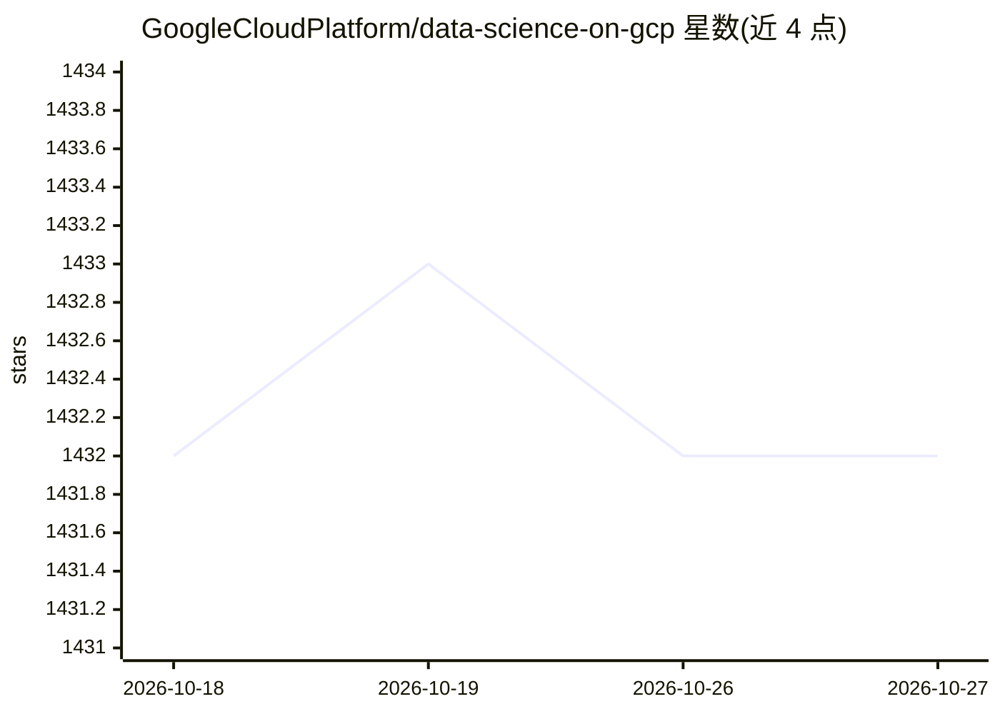

# GoogleCloudPlatform/data-science-on-gcp

⭐ — · [GitHub]() · 个人维护

**《Data Science on GCP》一书配套源码与实验集合**

O'Reilly《Data Science on the Google Cloud Platform》（第2版，2022）的配套代码仓库，作者 Valliappa Lakshmanan。代码覆盖 GCP 上的数据科学流程，配套 Qwiklabs Quest 实验路径并持续测试保持更新；第1版分支（edition1_tf2）已声明不再维护。运行方式为在 Google Cloud Shell 中打开，遇问题建议先跑对应 Qwiklab 实验。书籍内容涉及 TensorFlow 2.0、Cloud Functions 与 BigQuery ML。

## 筛选速览

| 维度 | 判定 | 备注 |
|---|---|---|
| AI 角色 | `ai-knowledge` | 知识聚合/清单类 |
| 许可风险 | `permissive` | — |
| 部署形态 | `None` |  |
| 模型依赖 | — | README 未给出锁定关系 |
| 硬件要求 | — | 无带数字的原话,不猜 |
| 安装摩擦 | `low` | 无编译、无系统依赖或容器化 |
| 成熟度 | — | 结构信号不足 |

## 能力要点

- 书籍配套源码，main 分支对应第2版
- 代码在 Qwiklabs 上持续测试、仓库保持更新
- 提供两条 Qwiklabs Quest 实验路径（数据科学与机器学习）
- 第1版分支已声明 obsolete 不再维护

## 适用场景

- 跟随书籍章节在 GCP 上实践数据科学流程
- 通过 Qwiklabs Quest 在云端跑通书中的数据处理与 ML 代码

## 场景标签

`数据分析` `教程课程` · 领域:效率与自动化

## 证据(README 行号)

> L3: Source code accompanying book:
> L5:  Data Science on the Google Cloud Platform, 2nd Edition

## 星数曲线

2026-10-18 1,432 → 2026-10-27 1,432（+0）

---
*卡片 v1 · prompt 1.4 · 生成 2026-10-21 · 置信度 high · 依据 README sha `46ba706a7ea3` · [字段定义](../../DATASET.md)*
