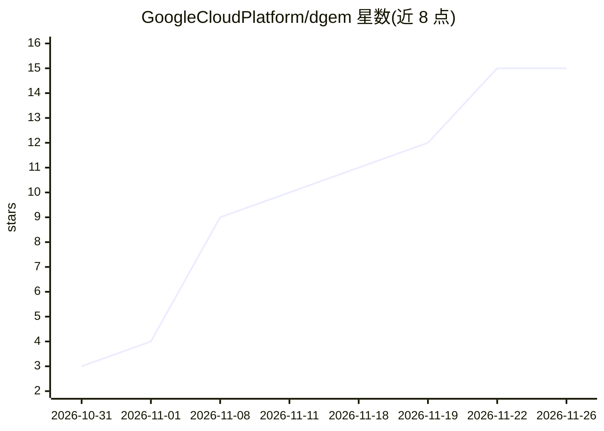

# GoogleCloudPlatform/dgem

⭐ 15 · Go · Apache-2.0 · 推送 2026-11-22 · [GitHub](https://github.com/GoogleCloudPlatform/dgem) · [官网](https://googlecloudplatform.github.io/dgem/) · 组织维护

**把 DiffusionGemma 变为零样本决策引擎，供开发者输出策略判定**

dgem 将离散扩散模型 DiffusionGemma（26B-A4B-it）转化为决策引擎：以 `.json.tmpl` 模板描述 boolean/choice/score 类型的问题，在单次前向传播中读出每个问题、每个选项的概率，并附 Shannon 熵换算的 hesitation 分数与按领域拟合的温度校准。低犹豫答案直接返回，高犹豫的可交由 Vertex AI gemini-3.8-flash 级联或人工。提供 CLI、HTTP 网关、MCP 服务器与内嵌 Decision Studio Web UI 四种使用面，附带 Genkit Go 流程示例和 bench-* 评测工具集。

## 筛选速览

| 维度 | 判定 | 备注 |
|---|---|---|
| AI 角色 | `ai-native` | 本体是模型或模型工具 |
| 许可风险 | `permissive` | Apache-2.0 |
| 部署形态 | `desktop` | 安装包/桌面程序 |
| 模型依赖 | — | README 未给出锁定关系 |
| 硬件要求 | — | 无带数字的原话,不猜 |
| 安装摩擦 | `low` | 无编译、无系统依赖或容器化 |
| 成熟度 | — | 结构信号不足 |

## 能力要点

- 单次前向传播读出所有问题所有选项的概率与 hesitation 分数
- 犹豫分级：低于阈值直接作答，高于阈值交接给更大模型或人工
- CLI / HTTP 网关 / MCP 服务器 / Decision Studio Web 四种交互面
- bench-* 评测工具与回归矩阵，按噪声判断版本变更

## 适用场景

- 客服工单、代码变更、安全告警的自动分诊与路由
- 策略变更频繁、不想重新训练分类器的判定流程
- 通过 MCP 把决策工具接入 agent 工作流
- 为部署对比基线做回归评测

## 场景标签

`工作流自动化` `模型评测` · 领域:效率与自动化

## 证据(README 行号)

> L3: **`dgem`** turns **DiffusionGemma** (`26B-A4B-it`, a discrete-diffusion Gemma 4) into a **decision engine**. You des
> L11: |**Decision engine** (`dgem decide`)|Compiles `.json.tmpl` *Policy-as-Template* files into one-pass multi-question 
> L14: |**Four surfaces**|CLI, HTTP gateway (`/api/decide`, `/v1/systemone`), MCP server (`dgem mcp`, `/mcp`), and the emb

## 星数曲线

2026-10-31 3 → 2026-11-26 15（+12）

---
*卡片 v1 · prompt 1.4 · 生成 2026-11-19 · 置信度 high · 依据 README sha `e4de77a430e3` · [字段定义](../../DATASET.md)*
