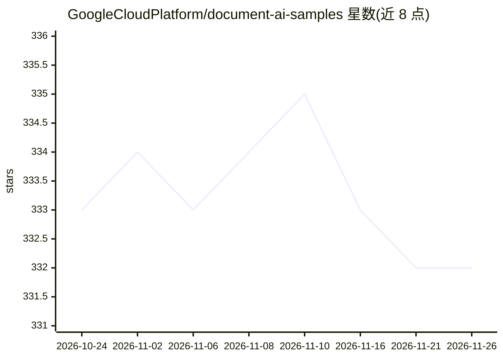

# GoogleCloudPlatform/document-ai-samples

⭐ 332 · Jupyter Notebook · Apache-2.0 · 推送 2026-11-20 · [GitHub](https://github.com/GoogleCloudPlatform/document-ai-samples) · [官网](https://cloud.google.com/document-ai) · 组织维护

**Google Cloud Document AI 的示例代码与演示集**

GoogleCloudPlatform 维护的 Document AI 示例仓库，收录 15 个官方示例（Apps Script 集成、Warehouse 批量摄取、BigQuery 连接器、税务处理流水线、全栈 Web 演示等）与社区示例，另附 4 个 Python Codelab（OCR、表单解析、专用处理器、处理器管理）。测试文档存放在公共 GCS 存储桶中。部分示例已被标记弃用并由 Document AI Toolbox 替代；仓库声明非官方支持产品，仅作演示用途。

## 筛选速览

| 维度 | 判定 | 备注 |
|---|---|---|
| AI 角色 | `ai-knowledge` | 知识聚合/清单类 |
| 许可风险 | `permissive` | Apache-2.0 |
| 部署形态 | `None` |  |
| 模型依赖 | — | README 未给出锁定关系 |
| 硬件要求 | — | 无带数字的原话,不猜 |
| 安装摩擦 | `low` | 无编译、无系统依赖或容器化 |
| 成熟度 | — | 结构信号不足 |

## 能力要点

- 15 个覆盖分析、分类、搜索文档的示例项目
- 4 个 Python Codelab 教程（OCR/表单解析等）
- 公共 GCS 存储桶提供测试文档文件
- 含 React 编写的 JSON 响应查看工具

## 适用场景

- 学习 Document AI API 的 OCR 与表单解析用法
- 搭建税务表单分类解析的处理流水线
- 将文档处理结果存入 BigQuery 做分析

## 场景标签

`教程课程` `OCR` · 领域:学习与行业

## 证据(README 行号)

> L10: The repository contains samples and Community Samples that demonstrate how to analyze, classify and search document
> L52: - Optical Character Recognition (OCR) with Document AI (Python)

## 星数曲线

2026-10-24 333 → 2026-11-26 332（-1）

---
*卡片 v1 · prompt 1.4 · 生成 2026-11-25 · 置信度 high · 依据 README sha `2fc6493a65de` · [字段定义](../../DATASET.md)*
