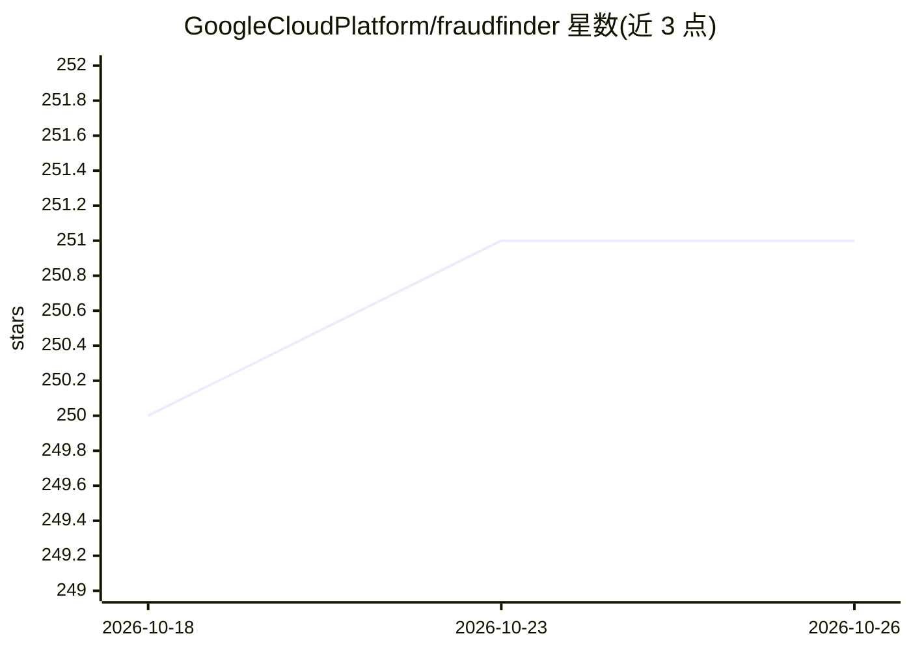

# GoogleCloudPlatform/fraudfinder

⭐ 251 · Jupyter Notebook · Apache-2.0 · 推送 2026-02-20 · [GitHub](https://github.com/GoogleCloudPlatform/fraudfinder) · 组织维护

**Google Cloud 实时欺诈检测端到端实验室教程系列**

Google Cloud 官方的 Data to AI 实验室系列，以实时交易欺诈检测为用例，通过一组 Jupyter 笔记本展示从数据仓库读取历史交易、流式读取新交易、EDA、特征工程、特征入库、模型训练与注册、评估、端点部署、实时推理到模型监控的完整 MLOps 流程。运行依赖 Google Cloud 项目与 Vertex AI Workbench 的 User-Managed Notebook 实例，包含 gcloud 命令启用 API 与创建 Pub/Sub 订阅，并在 Cloud Shell 中克隆本仓库执行。面向学习 Google Cloud 数据与 MLOps 架构的开发者与学习者。

## 筛选速览

| 维度 | 判定 | 备注 |
|---|---|---|
| AI 角色 | `ai-knowledge` | 知识聚合/清单类 |
| 许可风险 | `permissive` | Apache-2.0 |
| 部署形态 | `None` |  |
| 模型依赖 | — | README 未给出锁定关系 |
| 硬件要求 | — | 无带数字的原话,不猜 |
| 安装摩擦 | `low` | 无编译、无系统依赖或容器化 |
| 成熟度 | — | 结构信号不足 |

## 能力要点

- 覆盖 raw data 到 MLOps 的端到端流程（含 BigQuery ML 分支）
- 以实时欺诈检测为具体用例的系列笔记本（00-06 及 bqml 目录）
- 提供 gcloud 初始化脚本启用 API 并创建 Pub/Sub 流式订阅

## 适用场景

- 学习在 Google Cloud 上搭建实时欺诈检测系统
- 实践从特征工程到模型部署监控的完整 MLOps 流程
- 了解 BigQuery ML 与 Vertex AI Feature Store 的使用方式

## 场景标签

`教程课程` `MLOps` · 领域:学习与行业

## 证据(README 行号)

> L1: ## Fraudfinder - A comprehensive lab series on how to build a real-time fraud detection system on Google Cloud.
> L3: Fraudfinder FraudFinder is a golden Data to AI workshop to show an end-to-end architecture from raw data to MLOps, t
> L9: This repo is organized across various notebooks as:

## 星数曲线

2026-10-18 250 → 2026-10-26 251（+1）

---
*卡片 v1 · prompt 1.4 · 生成 2026-10-22 · 置信度 high · 依据 README sha `455ebb8cda0b` · [字段定义](../../DATASET.md)*
