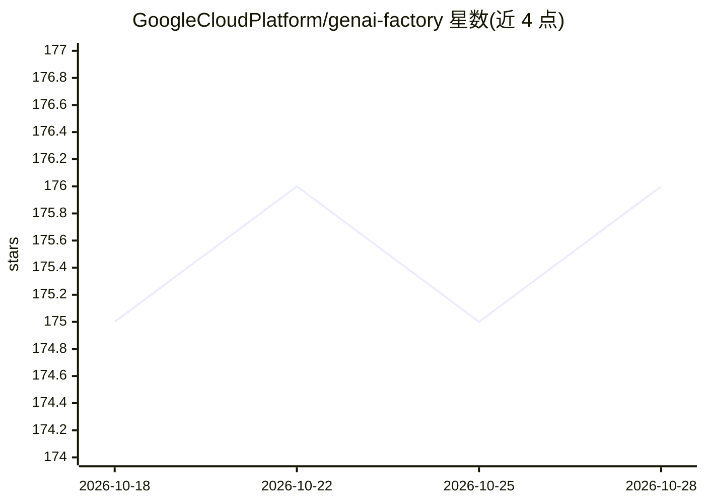

# GoogleCloudPlatform/genai-factory

⭐ 176 · HCL · Apache-2.0 · 推送 2026-10-28 · [GitHub](https://github.com/GoogleCloudPlatform/genai-factory) · 组织维护

**面向 GCP 的生成式 AI 基础设施端到端 Terraform 蓝图集**

由 GoogleCloudPlatform 维护的 GenAI 基础设施蓝图合集：以 Terraform（基于 Cloud Foundation Fabric 模块与 FAST 项目模板）在 GCP 上部署生成式 AI 应用，涵盖 Gemini Enterprise Agent Platform、Agent Runtime、Cloud Run 单部署（含自托管 Gemma 3 + Nvidia L4 GPU）、NL2SQL、多种 RAG 组合与 AI 搜索等 10 类工厂。每类分 0-prereqs（项目、服务账号、共享 VPC 网络栈）与 1-apps（平台资源与示例应用）两阶段部署；0-prereqs 为可选，可复用既有网络设施。兼容 Cloud Foundation Fabric v59.2.0 起，master 不保证兼容。

## 筛选速览

| 维度 | 判定 | 备注 |
|---|---|---|
| AI 角色 | `ai-ecosystem` | LLM/agent 周边工具 |
| 许可风险 | `permissive` | Apache-2.0 |
| 部署形态 | `None` |  |
| 模型依赖 | — | README 未给出锁定关系 |
| 硬件要求 | — | 无带数字的原话,不猜 |
| 安装摩擦 | `low` | 无编译、无系统依赖或容器化 |
| 成熟度 | — | 结构信号不足 |

## 能力要点

- 10 类工厂蓝图：Agent 平台、Cloud Run、NL2SQL、RAG、AI 搜索等
- Terraform 两阶段部署，最小权限原则（无默认服务账号、原始角色）
- 原生共享 VPC、防火墙策略、PGA 等网络组件自动创建，也可复用既有网络
- 兼容 Cloud Foundation Fabric FAST 项目模板（v59.2.0 起）

## 适用场景

- 在 GCP 上快速搭好符合安全最佳实践的 GenAI 应用基础设施
- 部署私有访问 VPC 资源的 Agent Runtime 或自托管 Gemma 3
- 搭建基于 Cloud Run/CloudSQL/AlloyDB/Vector Search 的 RAG 系统

## 场景标签

`RAG` `数据分析` · 领域:效率与自动化

## 证据(README 行号)

> L5: Genai-factory is a collection of **end-to-end blueprints to deploy generative AI infrastructures** in GCP, following
> L19: - Gemini Enterprise Agent Platform - A central place to deploy Gemini Enterprise applications and datastores, and t

## 星数曲线

2026-10-18 175 → 2026-10-28 176（+1）

---
*卡片 v1 · prompt 1.4 · 生成 2026-10-22 · 置信度 high · 依据 README sha `2b0379751c8f` · [字段定义](../../DATASET.md)*
