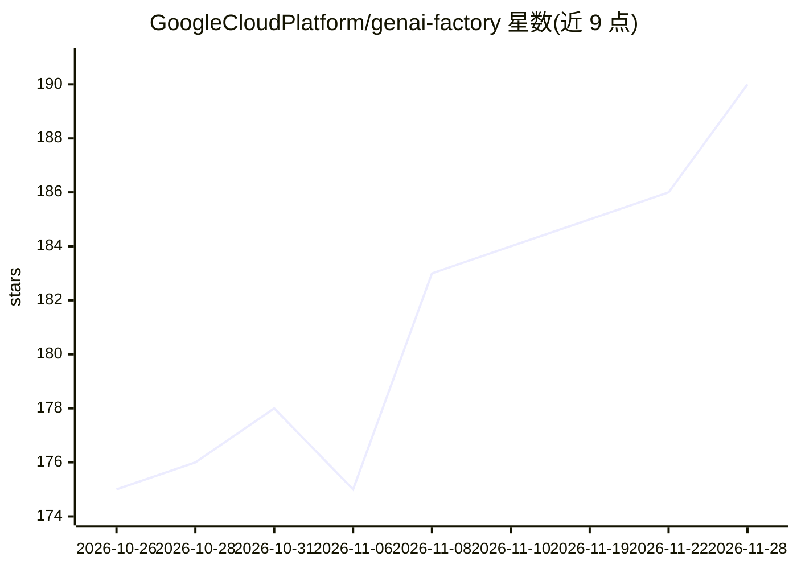

# GoogleCloudPlatform/genai-factory

⭐ 190 · HCL · Apache-2.0 · 推送 2026-11-26 · [GitHub](https://github.com/GoogleCloudPlatform/genai-factory) · 组织维护

**在 GCP 上部署生成式 AI 基础设施的 Terraform 蓝图集**

Google Cloud Platform 提供的一组端到端基础设施蓝图，用 Terraform（借助 Cloud Foundations Fabric 模块）在 GCP 上部署生成式 AI 环境，遵循最小权限与共享 VPC 等安全实践。包含十余个 "Factories" 场景：Gemini Enterprise 平台、Agent Runtime、Cloud Run 部署（含自托管 Gemma 3 / Nvidia L4）、私有化部署 Vertex AI Model Garden 开放模型、NL2SQL、多种 RAG 架构、AI 搜索、Dialogflow CX 等。部署分 0-prereqs（项目/网络/IAM）与 1-apps（应用）两个阶段，可与 Cloud Foundation Fabric FAST 项目工厂配合。面向需要在 GCP 上搭建生成式 AI 基础设施的工程团队。

## 筛选速览

| 维度 | 判定 | 备注 |
|---|---|---|
| AI 角色 | `ai-ecosystem` | LLM/agent 周边工具 |
| 许可风险 | `permissive` | Apache-2.0 |
| 部署形态 | `None` |  |
| 模型依赖 | — | README 未给出锁定关系 |
| 硬件要求 | — | 无带数字的原话,不猜 |
| 安装摩擦 | `low` | 无编译、无系统依赖或容器化 |
| 成熟度 | — | 结构信号不足 |

## 能力要点

- Terraform 实现的基础设施即代码蓝图，基于 Cloud Foundations Fabric 模块
- 覆盖 RAG（Cloud SQL/AlloyDB/Vector Search）、NL2SQL、AI 搜索等示例架构
- 支持通过 Private Service Connect 私有部署 Gemma 3 等开放模型（Nvidia L4）
- 含 Agent Registry / Agent Gateway 管理 MCP 服务器与 agent 的平台蓝图

## 适用场景

- 在 GCP 上快速搭建带安全基线的生成式 AI 平台
- 部署私有化的开放模型推理服务
- 搭建 RAG 或自然语言查库（NL2SQL）的基础设施
- 集中注册与治理 MCP 服务器和 agent 端点

## 场景标签

 · 领域:云计算/基础设施即代码

## 证据(README 行号)

> L5: Genai-factory is a collection of **end-to-end blueprints to deploy generative AI infrastructures** in GCP, following
> L7: - Embraces IaC best practices. Infrastructure is implemented in Terraform, leveraging Terraform resources and Cloud 
> L19: - Gemini Enterprise Agent Platform - A central place to deploy Gemini Enterprise applications and datastores, and t

## 星数曲线

2026-10-26 175 → 2026-11-28 190（+15）

---
*卡片 v1 · prompt 1.4 · 生成 2026-11-26 · 置信度 high · 依据 README sha `a7035a2d9cb6` · [字段定义](../../DATASET.md)*
