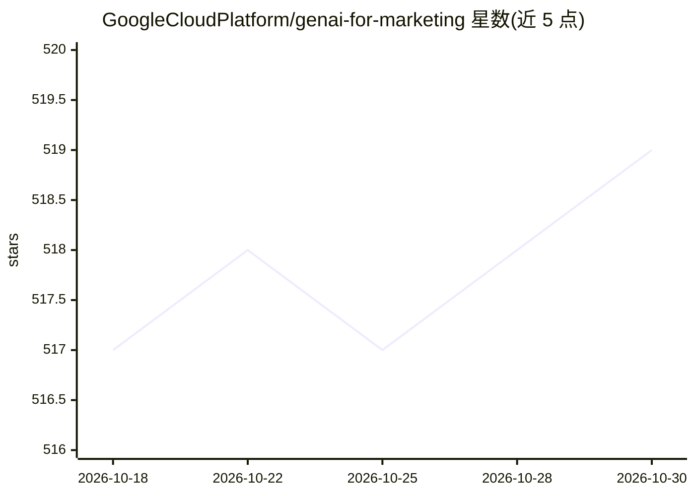

# GoogleCloudPlatform/genai-for-marketing

⭐ 519 · Jupyter Notebook · Apache-2.0 · 推送 2026-06-21 · [GitHub](https://github.com/GoogleCloudPlatform/genai-for-marketing) · [官网](https://cloud.google.com/vertex-ai/) · 组织维护

**谷歌云上生成式 AI 营销方案：前端+后端+部署指南**

Google CloudPlatform 官方仓库，提供可经 Terraform 一键部署的营销场景生成式 AI 解决方案：含前端 UI、后端 API 与部署脚本。功能覆盖 Looker 营销数据看板、自然语言转 SQL 的受众洞察查找、Google Trends 趋势分析与新闻摘要、Vertex AI Search 内容检索、基于 Vertex 基础模型生成邮件/文章/社交媒体图文，并可导出至 Google Workspace（Slides/Docs/Sheets）。附带 Jupyter 讲解 notebooks 与可定制的 config.toml（品牌信息、prompt 模板、模型名）。

## 筛选速览

| 维度 | 判定 | 备注 |
|---|---|---|
| AI 角色 | `ai-native` | 本体是模型或模型工具 |
| 许可风险 | `permissive` | Apache-2.0 |
| 部署形态 | `None` |  |
| 模型依赖 | locked-api |  |
| 硬件要求 | — | 无带数字的原话,不猜 |
| 安装摩擦 | `low` | 无编译、无系统依赖或容器化 |
| 成熟度 | — | 结构信号不足 |

## 能力要点

- Terraform 部署的端到端营销 GenAI 解决方案（前端+后端+基础设施）
- Vertex 基础模型生成邮件、网站文章、社交媒体帖与 PMax 素材
- 自然语言转 SQL 的对话式受众与洞察查找
- config.toml 集中配置品牌信息、prompt 模板与生成模型

## 适用场景

- 搭建面向营销团队的生成式 AI 内容生产平台
- 让非 SQL 用户用自然语言查询营销数据
- 基于 Google Trends 数据发现趋势并汇总相关新闻

## 场景标签

`AI 写作` `数据分析` `语义搜索` · 领域:效率与自动化

## 证据(README 行号)

> L34: * **Marketing Insights**: Utilize Looker Dashboards to access and visualize marketing data. Marketers can access an
> L38: * **Content Generation**: Reduce time for content generation with Vertex Foundation Models. Generate compelling and

## 星数曲线

2026-10-18 517 → 2026-10-30 519（+2）

---
*卡片 v1 · prompt 1.4 · 生成 2026-10-21 · 置信度 high · 依据 README sha `b607fff6d633` · [字段定义](../../DATASET.md)*
