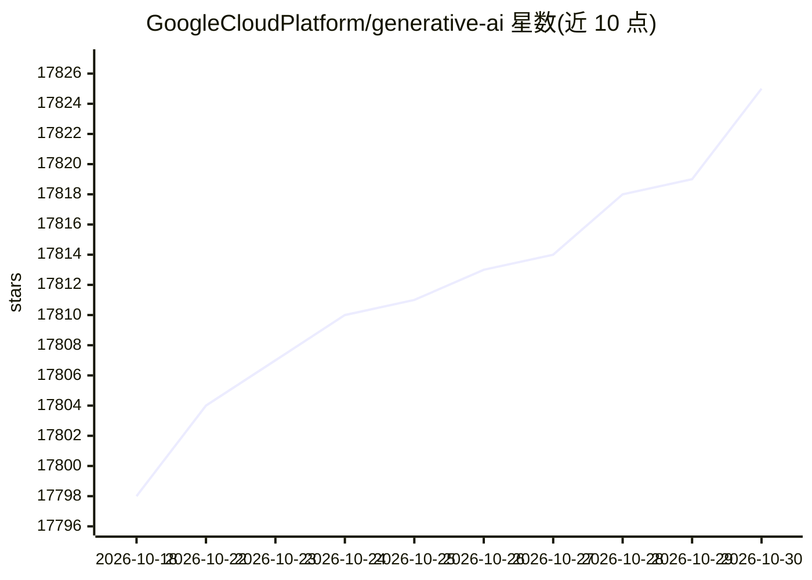

# GoogleCloudPlatform/generative-ai

⭐ 17,825 · Jupyter Notebook · Apache-2.0 · 推送 2026-10-29 · [GitHub](https://github.com/GoogleCloudPlatform/generative-ai) · [官网](https://docs.cloud.google.com/gemini-enterprise-agent-platform/) · 组织维护

**面向开发者的 Google Cloud 生成式 AI 示例与笔记本集**

Google Cloud 平台上的生成式 AI 示例仓库，收录 notebooks、代码示例与样例应用，演示如何使用 Agent Platform 开发与管理生成式 AI 工作流。按主题目录组织：Gemini 入门笔记本、Agent Search 网站与企业数据搜索、RAG 与 Grounding、Imagen/Veo 视觉、Chirp 语音，以及 Google Colab 与 Workbench 的环境配置说明。README 声明该仓库本身并非官方支持产品，代码仅作演示用途。

## 筛选速览

| 维度 | 判定 | 备注 |
|---|---|---|
| AI 角色 | `ai-ecosystem` | LLM/agent 周边工具 |
| 许可风险 | `permissive` | Apache-2.0 |
| 部署形态 | `None` |  |
| 模型依赖 | — | README 未给出锁定关系 |
| 硬件要求 | — | 无带数字的原话,不猜 |
| 安装摩擦 | `low` | 无编译、无系统依赖或容器化 |
| 成熟度 | — | 结构信号不足 |

## 动量与使用信号

- 维护:`active` — 距上次 push 1.4 天,年发版 0,305 位贡献者
- 涨星:近 1 天 **-4**(自 20261016 起算)
- 安装:github 包 `release-assets` 月下载无数据
- 平台:— · 协议:MCP

## 能力要点

- 提供 Gemini 入门笔记本、函数调用与样例应用目录
- RAG 与 Grounding 主题的跨目录笔记本索引
- 涵盖 Imagen/Veo 视觉与 Chirp 语音的从零构建示例
- 提供 Google Colab 与 Workbench 环境配置说明

## 适用场景

- 在 Google Cloud 上上手 Gemini 模型的入门学习
- 为企业数据搭建 RAG 或 Agent Search 搜索方案
- 查找视觉、语音等模态的示例代码与笔记本

## 场景标签

`教程课程` `RAG` · 领域:知识与检索

## 证据(README 行号)

> L5: This repository contains notebooks, code samples, sample apps, and other resources that demonstrate how to use, deve
> L15:  <code>gemini/</code>
> L47:  Instructions on how to set up Google Cloud, the Gen AI Python SDK, and notebook environments on Google Colab and W

## 星数曲线

2026-10-18 17,798 → 2026-10-30 17,825（+27）

---
*卡片 v1 · prompt 1.4 · 生成 2026-10-18 · 置信度 high · 依据 README sha `efae06353a13` · [字段定义](../../DATASET.md)*
