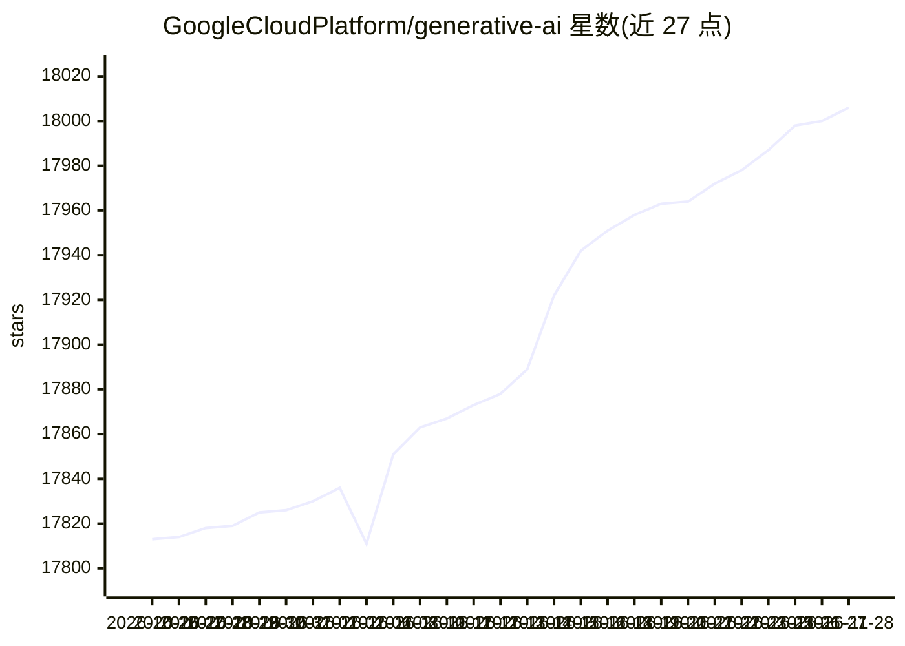

# GoogleCloudPlatform/generative-ai

⭐ 18,006 · Jupyter Notebook · Apache-2.0 · 推送 2026-11-27 · [GitHub](https://github.com/GoogleCloudPlatform/generative-ai) · [官网](https://docs.cloud.google.com/gemini-enterprise-agent-platform/) · 组织维护

**Google Cloud 生成式 AI 示例代码与笔记本集合**

Google Cloud Platform 维护的示例仓库，包含 notebooks、代码示例、示例应用等资源，演示如何使用 Agent Platform 使用、开发和管理生成式 AI 工作流。按主题组织目录：Gemini 入门笔记本与示例应用、Agent Search 托管搜索方案、RAG 与 Grounding 索引、Imagen/Veo 视觉、Chirp 语音，以及 Google Colab 与 Workbench 的环境配置说明；另附学习资源与相关仓库索引。README 声明本仓库非官方支持产品，代码仅作演示用途。

## 筛选速览

| 维度 | 判定 | 备注 |
|---|---|---|
| AI 角色 | `ai-knowledge` | 知识聚合/清单类 |
| 许可风险 | `permissive` | Apache-2.0 |
| 部署形态 | `None` |  |
| 模型依赖 | — | README 未给出锁定关系 |
| 硬件要求 | — | 无带数字的原话,不猜 |
| 安装摩擦 | `low` | 无编译、无系统依赖或容器化 |
| 成熟度 | — | 结构信号不足 |

## 动量与使用信号

- 维护:`active` — 距上次 push 1.4 天,年发版 0,305 位贡献者
- 涨星:近 1 天 **-4**(自 20261016 起算)
- 安装:github 包 `release-assets` 月下载无数据
- 平台:— · 协议:MCP

## 能力要点

- 按主题组织的示例目录：gemini/search/rag-grounding/vision/audio/setup-env
- 提供 Google Colab 与 Workbench 上 Gen AI Python SDK 的环境配置说明
- 汇总 ADK 示例、Agent Starter Pack、Gemini Cookbook 等相关仓库索引
- RAG 与 Grounding 主题的跨目录笔记本索引

## 适用场景

- 在 Google Cloud 上学习 Gemini 模型的调用与功能调用示例
- 使用 Agent Search 快速搭建网站与企业数据的搜索引擎
- 参考示例笔记本构建 RAG 与 Grounding 应用
- 了解 Imagen、Veo、Chirp 等模型的从零构建方法

## 场景标签

`RAG` `教程课程` `语义搜索` · 领域:知识与检索

## 证据(README 行号)

> L8: This repository contains notebooks, code samples, sample apps, and other resources that demonstrate how to use, deve
> L20:  Discover Gemini through starter notebooks, use cases, function calling, sample apps, and more.

## 星数曲线

2026-10-26 17,813 → 2026-11-28 18,006（+193）

---
*卡片 v1 · prompt 1.4 · 生成 2026-11-22 · 置信度 high · 依据 README sha `f9fcababbd43` · [字段定义](../../DATASET.md)*
