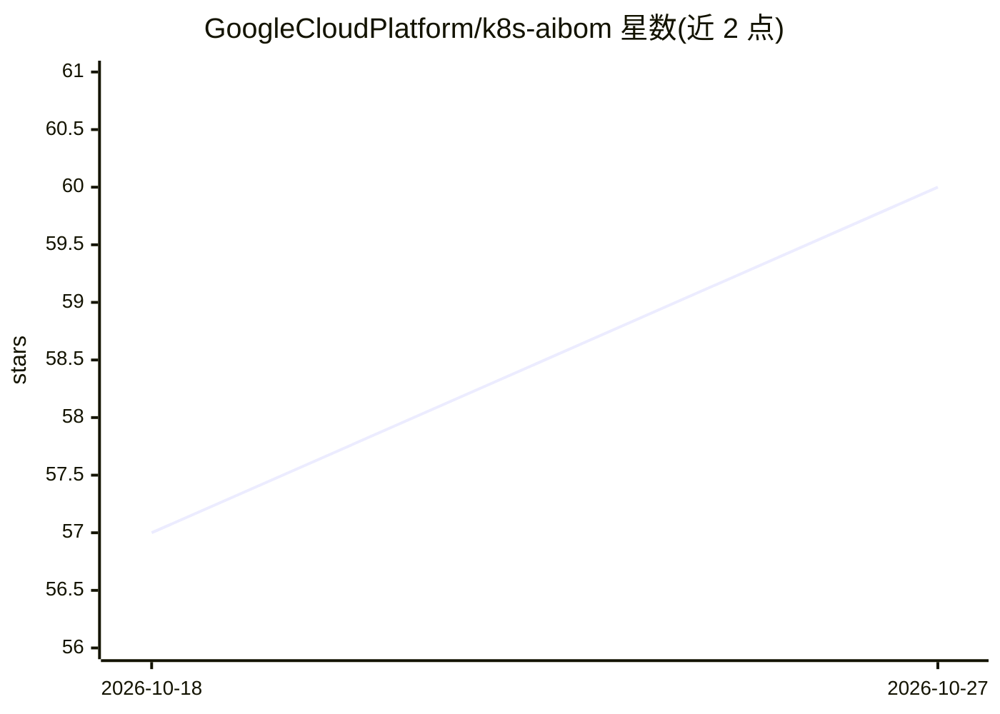

# GoogleCloudPlatform/k8s-aibom

⭐ — · [GitHub]() · 组织维护

**K8s 控制器：运行时盘点集群内 AI 负载并生成 ML-BOM**

非特权 Kubernetes 控制器，对推理服务、Agent 栈、RAG 组件、训练任务与评测框架做运行时清点，为每个 AI 负载生成带置信度分级（declared/verified/inferred/unresolved）与证据定位的 CycloneDX 1.6 ML-BOM 文档，并通过 Sigstore 验证模型签名。识别 vLLM/TGI/Triton/Ollama 等运行时、LangChain/AutoGen 等 Agent 框架、Milvus/Qdrant 等向量库。产物对应 EU AI Act、NIST AI RMF、ISO/IEC 42001 的证据需求（不自证合规）。以 Helm 图表或 kubectl 清单安装，附 kubectl 插件；单 Deployment 部署，无需特权容器或节点级代理。

## 筛选速览

| 维度 | 判定 | 备注 |
|---|---|---|
| AI 角色 | `ai-ecosystem` | LLM/agent 周边工具 |
| 许可风险 | `permissive` | — |
| 部署形态 | `library` | 以包/库形式分发 |
| 模型依赖 | — | README 未给出锁定关系 |
| 硬件要求 | — | 无带数字的原话,不猜 |
| 安装摩擦 | `low` | 无编译、无系统依赖或容器化 |
| 成熟度 | — | 结构信号不足 |

## 能力要点

- 运行时清点推理/Agent/RAG/训练/评测五类 AI 负载并生成 CycloneDX 1.6 ML-BOM
- 四级置信度模型，每个属性带证据定位
- Sigstore 签名验证升级至 verified 层级
- kubectl-aibom 插件支持 summary/find/view/verify 命令

## 适用场景

- 为 AI 治理审计（EU AI Act / NIST AI RMF / ISO 42001）提供部署系统的运行时证据
- 事件响应时定位某运行时/模型/镜像当前在哪些命名空间服务
- 跟踪集群内 AI 组件（模型、运行时、向量库、Agent 框架）的清单变化

## 场景标签

`网络安全` · 领域:学习与行业

## 证据(README 行号)

> L3: A Kubernetes controller that generates [CycloneDX 1.6 ML-BOM][cyclonedx-ml] documents for AI workloads at runtime — 
> L22: k8s-aibom produces that evidence as a side effect of normal cluster operation. Install the controller, opt in a nam
> L49: For each tracked workload, the controller scrapes the workload spec and current pod status, applies category-specif

## 星数曲线

2026-10-18 57 → 2026-10-27 60（+3）

---
*卡片 v1 · prompt 1.4 · 生成 2026-10-24 · 置信度 high · 依据 README sha `fa0ae1953f45` · [字段定义](../../DATASET.md)*
