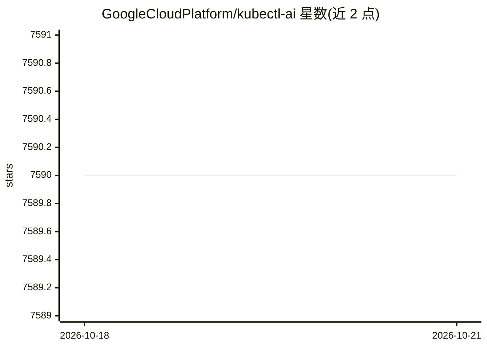

# GoogleCloudPlatform/kubectl-ai

⭐ 7,590 · Go · Apache-2.0 · 推送 2026-07-15 · [GitHub](https://github.com/GoogleCloudPlatform/kubectl-ai) · 组织维护

**AI 驱动的 Kubernetes 命令行助手：自然语言转 kubectl 操作**

Google Cloud Platform 维护的 kubectl 插件/CLI，用 LLM 将自然语言意图转为 Kubernetes 操作，内置 kubectl 与 bash 工具，支持自定义工具扩展。支持 Gemini（默认）、Vertex AI、Azure OpenAI、OpenAI、Grok、AWS Bedrock 及本地 ollama/llama.cpp，兼容 OpenAI 兼容 API（如阿里云 qwen）。提供交互式与单次任务模式、会话持久化、Docker 镜像、MCP 客户端/服务器模式（可将 kubectl 工具暴露给 Claude/Cursor/VS Code）。需本机已安装并配置 kubectl。

## 筛选速览

| 维度 | 判定 | 备注 |
|---|---|---|
| AI 角色 | `ai-native` | 本体是模型或模型工具 |
| 许可风险 | `permissive` | Apache-2.0 |
| 部署形态 | `desktop` | 安装包/桌面程序 |
| 模型依赖 | local-ok | 支持本地模型 |
| 硬件要求 | — | 无带数字的原话,不猜 |
| 安装摩擦 | `low` | 无编译、无系统依赖或容器化 |
| 成熟度 | — | 结构信号不足 |

## 能力要点

- 自然语言转 Kubernetes 操作，内置 kubectl 与 bash 工具
- 多 LLM 提供商：Gemini/VertexAI/Azure OpenAI/OpenAI/Grok/Bedrock 及本地 ollama/llama.cpp
- MCP 双模式：作为客户端接入外部 MCP 服务器，也可作为服务器向 Claude/Cursor 等暴露 kubectl 工具
- 会话持久化与 YAML 配置文件（命令行/配置/环境变量三层配置）

## 适用场景

- 用自然语言查询和操作 Kubernetes 集群
- 让 AI 解释报错日志或 Pod 状态
- 通过 MCP 把 kubectl 工具接入 Claude、Cursor 等 AI 客户端

## 场景标签

`AI 助手` · 领域:对话与助手

## 证据(README 行号)

> L8: `kubectl-ai` acts as an intelligent interface, translating user intent into
> L71: `kubectl-ai` supports AI models from `gemini`, `vertexai`, `azopenai`, `openai`, `grok`, `bedrock` and local LLM pr
> L237: `kubectl-ai` leverages LLMs to suggest and execute Kubernetes operations using a set of powerful tools. It comes w

## 星数曲线

2026-10-18 7,590 → 2026-10-21 7,590（+0）

---
*卡片 v1 · prompt 1.4 · 生成 2026-10-20 · 置信度 high · 依据 README sha `d45e5b3f70db` · [字段定义](../../DATASET.md)*
