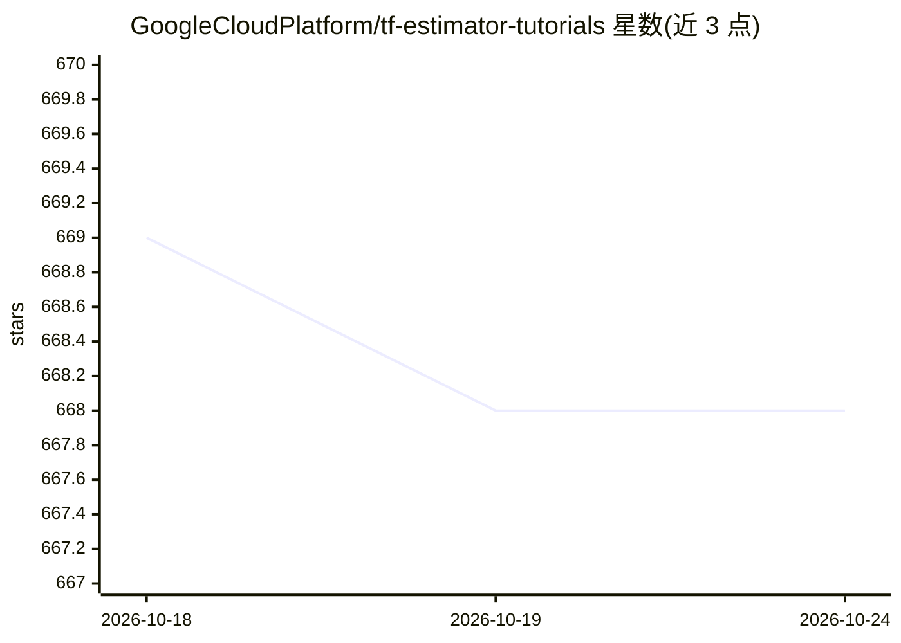

# GoogleCloudPlatform/tf-estimator-tutorials

⭐ 668 · Jupyter Notebook · Apache-2.0 · 推送 2026-05-08 · [GitHub](https://github.com/GoogleCloudPlatform/tf-estimator-tutorials) · [官网](https://www.tensorflow.org/programmers_guide/estimators) · 组织维护

**TensorFlow Estimator API 系统化教程仓库，覆盖多种机器学习任务**

GoogleCloudPlatform 维护的 TF estimator 教程集合：以标准化、系统化方式演示如何用 canned/custom estimator 训练模型，覆盖分类、回归、聚类、时间序列、自编码、CNN 图像与文本分类等任务；并演示 tf.Transform 预处理、TFMA 模型评估、tf.Hub 文本嵌入、元数据驱动的 feature_column 构建、CSV/TFRecord 数据输入管道、Wide & Deep 模型与导出模型的 csv/json 服务方式。教程基于 TF v1.x estimator API。

## 筛选速览

| 维度 | 判定 | 备注 |
|---|---|---|
| AI 角色 | `ai-knowledge` | 知识聚合/清单类 |
| 许可风险 | `permissive` | Apache-2.0 |
| 部署形态 | `None` |  |
| 模型依赖 | — | README 未给出锁定关系 |
| 硬件要求 | — | 无带数字的原话,不猜 |
| 安装摩擦 | `low` | 无编译、无系统依赖或容器化 |
| 成熟度 | — | 结构信号不足 |

## 能力要点

- canned 与 custom estimator 的训练实现
- tf.Transform / TFMA / tf.Hub 集成示例
- 元数据驱动的 feature_column 构建方法（数值/词表/哈希桶/identity）
- csv 与 json 输入的 SavedModel 导出与服务

## 适用场景

- 学习 TensorFlow estimator API 的系统化用法
- 参考特征工程与数据输入管道的标准实现
- 了解 Wide & Deep 模型的特征列准备方式

## 场景标签

`教程课程` · 领域:学习与行业

## 证据(README 行号)

> L6: ## Theses tutorials use the TF estimator APIs to cover:
> L8: * Various ML tasks, currently covering:

## 星数曲线

2026-10-18 669 → 2026-10-24 668（-1）

---
*卡片 v1 · prompt 1.4 · 生成 2026-10-21 · 置信度 high · 依据 README sha `315b50d12969` · [字段定义](../../DATASET.md)*
