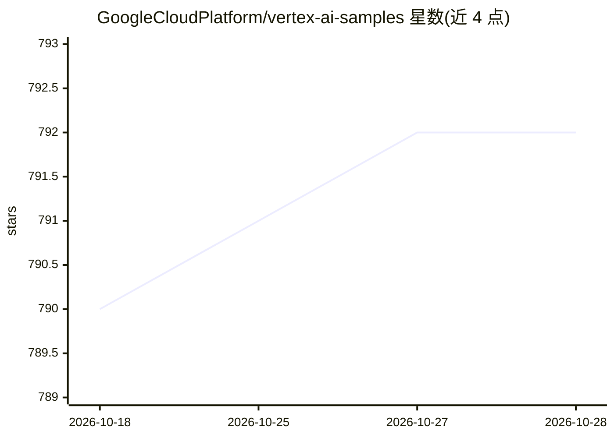

# GoogleCloudPlatform/vertex-ai-samples

⭐ 792 · Jupyter Notebook · Apache-2.0 · 推送 2026-10-23 · [GitHub](https://github.com/GoogleCloudPlatform/vertex-ai-samples) · [官网](https://cloud.google.com/vertex-ai) · 组织维护

**Vertex AI 官方示例库：notebook 与代码演示 ML/生成式 AI 工作流**

GoogleCloudPlatform 维护的示例资源库，收录 notebook、代码示例、示例应用与技能，演示如何使用、开发和管理 Google Cloud Vertex AI 上的机器学习与生成式 AI 工作流。内容按 Model Garden、Feature Store、AutoML、自定义训练、Ray、预测部署、Model Registry、Explainable AI、Pipelines 等产品分类组织。notebook 可在 Colab、Colab Enterprise 或 Vertex AI Workbench 中打开运行，使用前需具备 Google Cloud 项目。README 声明本库非官方支持产品，代码仅供演示。

## 筛选速览

| 维度 | 判定 | 备注 |
|---|---|---|
| AI 角色 | `ai-knowledge` | 知识聚合/清单类 |
| 许可风险 | `permissive` | Apache-2.0 |
| 部署形态 | `None` |  |
| 模型依赖 | — | README 未给出锁定关系 |
| 硬件要求 | — | 无带数字的原话,不猜 |
| 安装摩擦 | `low` | 无编译、无系统依赖或容器化 |
| 成熟度 | — | 结构信号不足 |

## 能力要点

- 按 Vertex AI 产品线分类的 notebook 与代码示例（AutoML/Model Garden/Pipelines 等）
- notebook 支持 Colab、Colab Enterprise、Vertex AI Workbench 三种运行环境
- 覆盖 Gemini、Gemma、Llama 3、Claude 3 等 Model Garden 模型的使用示例

## 适用场景

- 学习如何在 Vertex AI 上训练、部署和管理模型
- 查找 Vertex AI 各服务（Feature Store、Pipelines 等）的官方示例代码
- 在 Colab 中快速运行 Vertex AI 教学 notebook

## 场景标签

`教程课程` · 领域:学习与行业

## 证据(README 行号)

> L3: This repository contains notebooks, code samples, sample apps, skills, and other resources that demonstrate how to u
> L7: Vertex AI is a fully-managed, unified AI development platform for building and using generative AI. This repository 
> L39: │   ├── official - Notebooks demonstrating use of each Vertex AI service

## 星数曲线

2026-10-18 790 → 2026-10-28 792（+2）

---
*卡片 v1 · prompt 1.4 · 生成 2026-10-21 · 置信度 high · 依据 README sha `29bbac241d4c` · [字段定义](../../DATASET.md)*
