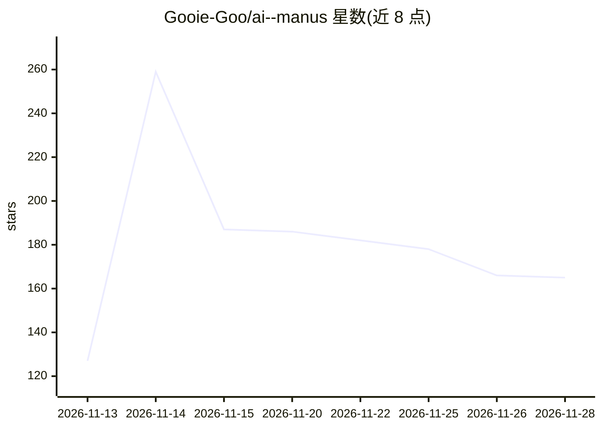

# Gooie-Goo/ai--manus

⭐ 165 · Apache-2.0 · 推送 2026-11-14 · [GitHub](https://github.com/Gooie-Goo/ai--manus) · 个人维护

**自主执行代码与控制浏览器的通用 AI Agent 助手**

面向家庭、学习与轻量办公场景的自主 AI Agent：用户以自然语言下达指令，Agent 自行编写并执行脚本、打开网页、填写表单、完成多步骤任务，脚本与浏览器操作可在同一流程中衔接。README 声称其定位于小规模任务而非企业平台，无需开发者背景。给出最低双核 CPU、4 GB 内存的兼容性表，但未提供任何安装命令、下载渠道详情或技术架构说明，仅出现 'Download Manus / PROMO2026' 字样。

## 筛选速览

| 维度 | 判定 | 备注 |
|---|---|---|
| AI 角色 | `ai-native` | 本体是模型或模型工具 |
| 许可风险 | `permissive` | Apache-2.0 |
| 部署形态 | `None` |  |
| 模型依赖 | — | README 未给出锁定关系 |
| 硬件要求 | — | 无带数字的原话,不猜 |
| 安装摩擦 | `low` | 无编译、无系统依赖或容器化 |
| 成熟度 | — | 结构信号不足 |

## 能力要点

- 自主编写并执行代码完成多步骤任务
- 浏览器控制：导航网页、填写表单、采集信息
- 代码执行与浏览器操作可在同一工作流中衔接
- 声明会话间记忆并复用已学工作流模式

## 适用场景

- 让 Agent 代为完成重复性的网页查询与表单填写
- 学习中运行小脚本、整理研究笔记
- 远程工作者从多个页面收集信息并准备摘要

## 场景标签

`浏览器自动化` `AI 助手` `编码 Agent` · 领域:效率与自动化

## 证据(README 行号)

> L10: - **Autonomous Code Execution:** Manus AI agent runs code on its own to complete tasks, so you can focus on decisio
> L18: Manus is an autonomous AI agent designed to run code and control a browser on your behalf. Instead of acting like a

## 星数曲线

2026-11-13 127 → 2026-11-28 165（+38）

---
*卡片 v1 · prompt 1.4 · 生成 2026-11-17 · 置信度 mid · 依据 README sha `4347b4dd3fa7` · [字段定义](../../DATASET.md)*
