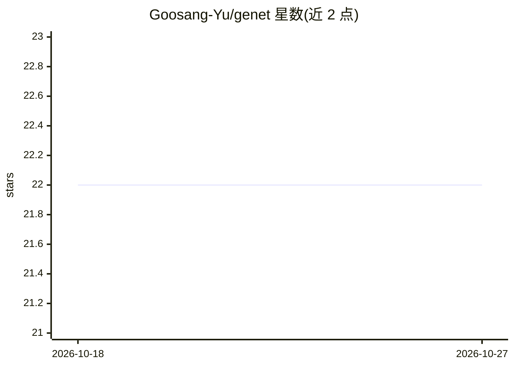

# Goosang-Yu/genet

⭐ 22 · Python · 推送 2025-12-02 · [GitHub](https://github.com/Goosang-Yu/genet) · 个人维护

**基因组编辑分析 Python 库：gRNA 设计与编辑效率预测**

GenET（Genome Editing Toolkit）是面向基因组编辑研究的 Python 函数库，功能覆盖 guideRNA 设计、饱和文库设计、深度测序数据分析和 gRNA 活性预测。内置 DeepPrime 模型（Yu et al. Cell 2023）用于预测 prime editing pegRNA 效率，同时计算 DeepSpCas9 分数，模型基于 PyTorch 开发、计算 DeepSpCas9 需要 TensorFlow>=2.6；另提供 database 模块从 NCBI 下载基因组组装与注释文件。通过 conda 虚拟环境加 pip 安装，作者声明项目仍处于早期开发阶段。

## 筛选速览

| 维度 | 判定 | 备注 |
|---|---|---|
| AI 角色 | `ai-native` | 本体是模型或模型工具 |
| 许可风险 | `none` | — |
| 部署形态 | `library` | 以包/库形式分发 |
| 模型依赖 | — | README 未给出锁定关系 |
| 硬件要求 | — | 无带数字的原话,不猜 |
| 安装摩擦 | `low` | 无编译、无系统依赖或容器化 |
| 成熟度 | `idea` | |

## 能力要点

- DeepPrime pegRNA 效率预测，支持选择 PE 系统与细胞类型
- DeepSpCas9 预测分数同时计算
- database 模块从 NCBI 下载物种基因组组装文件
- 计划功能含 guideRNA 设计、饱和文库设计与测序数据分析

## 适用场景

- 为特定基因设计基因组编辑实验并预测 gRNA 活性
- 基于测序数据分析基因组编辑结果
- 批量下载 NCBI 基因组参考文件用于分析流程

## 场景标签

 · 领域:生物信息学/基因组编辑

## 证据(README 行号)

> L30: - Predict the activtiy of specific guideRNAs or all guideRNAs designed for editing a specific product.
> L79: DeepPrime is a prediction model for evaluating prime editing guideRNAs (pegRNAs) that target specific target sites 

## 星数曲线

2026-10-18 22 → 2026-10-27 22（+0）

---
*卡片 v1 · prompt 1.4 · 生成 2026-10-27 · 置信度 high · 依据 README sha `5f9d26fa3634` · [字段定义](../../DATASET.md)*
