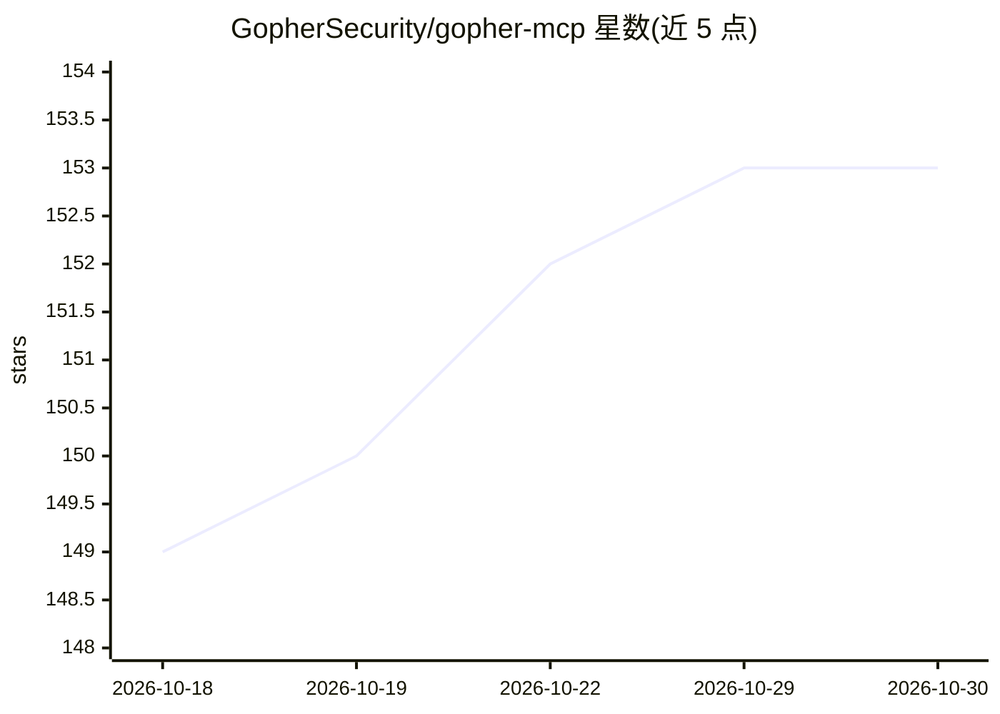

# GopherSecurity/gopher-mcp

⭐ 153 · C++ · Apache-2.0 · 推送 2026-10-29 · [GitHub](https://github.com/GopherSecurity/gopher-mcp) · [官网](https://gopher.security) · 组织维护

**面向 C++ 开发者的 MCP SDK：构建 MCP 服务器与客户端**

Model Context Protocol 的 C++ 实现（C++14），用于构建 MCP 服务器与客户端，支持 stdio、HTTP+SSE、HTTPS+SSE、Streamable HTTP、WebSocket、TCP 六种传输，实现 JSON-RPC 2.0 与 tools/resources/prompts 能力，提供连接池、熔断、限流、TLS、结构化日志等特性，并通过稳定 C API 提供 Python、TypeScript、Go、Rust、Java、C#、Ruby 绑定。目标场景包括嵌入式、实时交易、游戏引擎与低延迟后端。安装需自行编译：C++14 编译器、CMake 3.10+、libevent 2.1+，OpenSSL 可选；Windows 走 Cygwin+MinGW 脚本。

## 筛选速览

| 维度 | 判定 | 备注 |
|---|---|---|
| AI 角色 | `ai-ecosystem` | LLM/agent 周边工具 |
| 许可风险 | `permissive` | Apache-2.0 |
| 部署形态 | `desktop` | 安装包/桌面程序 |
| 模型依赖 | — | README 未给出锁定关系 |
| 硬件要求 | — | 无带数字的原话,不猜 |
| 安装摩擦 | `medium` | 含编译或系统依赖之一 |
| 成熟度 | — | 结构信号不足 |

## 能力要点

- 实现 MCP 2025-06-18/2025-11-25/2026-07-28 规范与 JSON-RPC 2.0
- 六种传输：stdio、HTTP+SSE、HTTPS+SSE、Streamable HTTP、WebSocket、TCP
- 经稳定 C API 提供 Python/TypeScript/Go/Rust/Java/C#/Ruby 绑定
- 连接池、熔断、限流、退避重试、优雅关闭等生产特性

## 适用场景

- 在 C++ 项目中实现 MCP 服务器供 AI 模型调用工具与资源
- 从 Python/Go/Rust 等语言经 C API 复用该 SDK
- 嵌入式、实时交易、游戏引擎等低延迟环境接入 MCP

## 场景标签

 · 领域:AI 基础设施/MCP 协议

## 证据(README 行号)

> L9: **The most comprehensive C++ implementation of the Model Context Protocol (MCP)** for building AI-powered applicatio
> L55: - **Developers** to expose tools and resources to AI models
> L225: Yes. MCP is model-agnostic. Any AI system that supports MCP can use servers built with this SDK.

## 星数曲线

2026-10-18 149 → 2026-10-30 153（+4）

---
*卡片 v1 · prompt 1.4 · 生成 2026-10-22 · 置信度 high · 依据 README sha `323fb05f27ce` · [字段定义](../../DATASET.md)*
