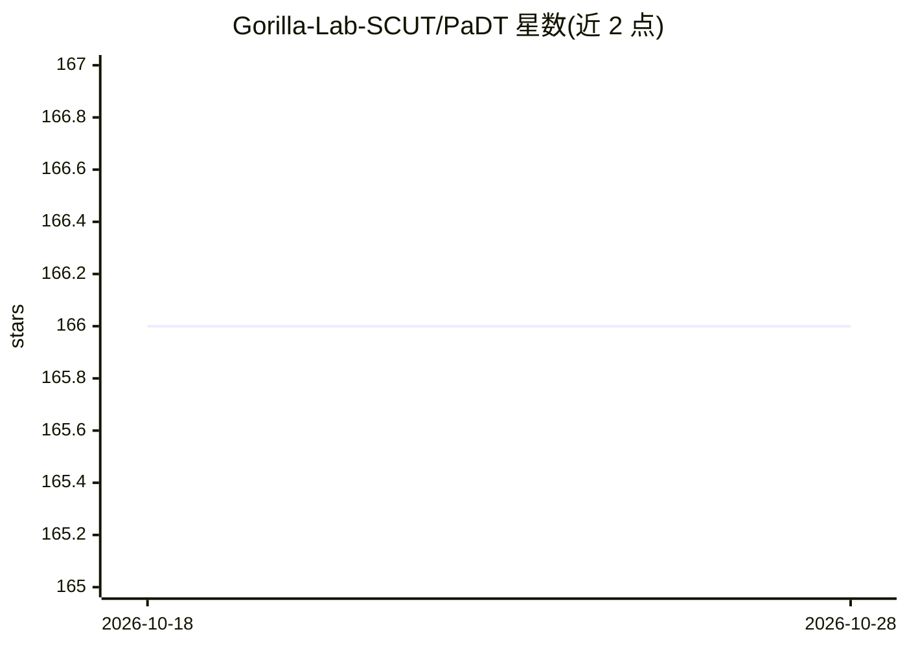

# Gorilla-Lab-SCUT/PaDT

⭐ 166 · Python · Apache-2.0 · 推送 2026-08-03 · [GitHub](https://github.com/Gorilla-Lab-SCUT/PaDT) · [官网](https://arxiv.org/abs/2510.01954) · 组织维护 · 中文 README

**MLLM 统一视觉任务范式：视觉 patch 作为可解码 token 输出定位与分割**

ICLR 2026 论文官方实现。提出 Patch-as-Decodable-Token（PaDT）范式：多模态大模型通过视觉参考 token（VRT）直接以视觉 patch 表示目标，在自回归生成中预测视觉 token，再经轻量级 PaDT 解码器输出定位/分割等低层结果。基于 Qwen2.5VL-3B/7B 提供 OVD/REC/RIC 及多任务 Pro 模型共 8 个 checkpoint。提供 git clone + conda + setup.sh 安装、数据预处理、8×96GB GPU 训练脚本与评测脚本。

## 筛选速览

| 维度 | 判定 | 备注 |
|---|---|---|
| AI 角色 | `ai-native` | 本体是模型或模型工具 |
| 许可风险 | `permissive` | Apache-2.0 |
| 部署形态 | `None` |  |
| 模型依赖 | — | README 未给出锁定关系 |
| 硬件要求 | — | 无带数字的原话,不猜 |
| 安装摩擦 | `low` | 无编译、无系统依赖或容器化 |
| 成熟度 | `idea` | |

## 能力要点

- 视觉参考 token（VRT）直接以视觉 patch 表示目标，替代文本坐标
- 轻量级可插拔 PaDT 解码器输出定位/分割结果
- 基于 Qwen2.5VL-3B/7B 的 8 个模型 checkpoint（OVD/REC/RIC/Pro）
- 提供训练脚本、预处理脚本与 COCO/RefCOCO 评测脚本

## 适用场景

- 在开放词汇检测、指代理解/分割、指代图像描述任务上运行推理
- 复现论文训练流程或基于已发布数据集微调
- 对比 VRT 与文本坐标生成两种范式的效果

## 场景标签

`多模态` `目标检测` `模型训练` · 领域:感知与多模态

## 证据(README 行号)

> L11: We are pleased to introduce **Patch-as-Decodable Token (PaDT)**, a unified paradigm that enables multimodal large l
> L15: By introducing VRTs, we achieve **semantic reasoning and object-specific visual tokens prediction** within the MLLM
> L17: As illustrated in Figure C, we have validated PaDT across four major visual perception and understanding tasks. In 

## 星数曲线

2026-10-18 166 → 2026-10-28 166（+0）

---
*卡片 v1 · prompt 1.4 · 生成 2026-10-22 · 置信度 high · 依据 README sha `a37e8b5f970d` · [字段定义](../../DATASET.md)*
