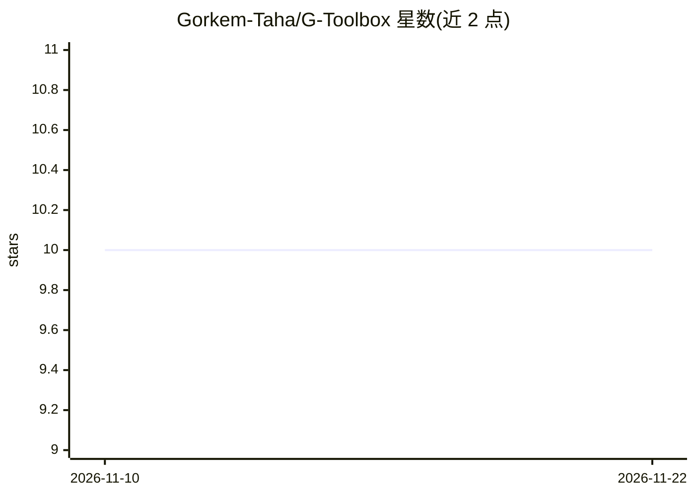

# Gorkem-Taha/G-Toolbox

⭐ 10 · Python · NOASSERTION · 推送 2026-11-18 · [GitHub](https://github.com/Gorkem-Taha/G-Toolbox) · 个人维护

**本地运行的 AI 图像处理与文件转换工具箱，零云上传**

集成本地 AI 与媒体处理的桌面工具箱：背景移除（U²-Net）、物体/水印擦除（LaMa）、2×/4× 超分辨率（Real-ESRGAN）、语音分离（Demucs）、语音转文字（faster-whisper），以及格式转换、PDF 工具、AES-256 加密等 13 类工具。全部在本地处理，无需账号与 API key；手机可经 Wi-Fi 配对后使用电脑算力。AI 引擎按需在应用内安装（约 460 MB 模型权重），默认装 CPU 版 PyTorch，NVIDIA GPU 可换 CUDA 版加速。非商业许可（CC BY-NC 4.0）。

## 筛选速览

| 维度 | 判定 | 备注 |
|---|---|---|
| AI 角色 | `ai-native` | 本体是模型或模型工具 |
| 许可风险 | `none` | NOASSERTION |
| 部署形态 | `desktop` | 安装包/桌面程序 |
| 模型依赖 | — | README 未给出锁定关系 |
| 硬件要求 | — | 无带数字的原话,不猜 |
| 安装摩擦 | `medium` | 含编译或系统依赖之一 |
| 成熟度 | — | 结构信号不足 |

## 能力要点

- 13 类工具：AI 图像处理、媒体转换、AES-256 加密、字幕烧录等
- 本地运行，服务器仅监听 127.0.0.1，无需账号与 API key
- AI 引擎在应用内按需安装，支持 CPU 与可选 CUDA 加速
- 下载验证：SHA-256 清单加 ed25519 签名更新

## 适用场景

- 离线批量转换图片、音频、视频格式
- 本地去除图片背景或水印
- 语音转文字并导出 SRT 字幕
- 手机通过 Wi-Fi 调用电脑的本地 AI 工具

## 场景标签

`语音识别` `图像视频处理` · 领域:感知与多模态

## 证据(README 行号)

> L9: G-Toolbox is an all-in-one workspace for media, documents and local AI. Your files are
> L25: |✂️ Background remover|Cuts out the main subject as a transparent PNG|U²-Net (rembg)|
> L31: |📝 Transcriber|Speech to text: TXT, SRT, WebVTT or JSON|faster-whisper|

## 星数曲线

2026-11-10 10 → 2026-11-22 10（+0）

---
*卡片 v1 · prompt 1.4 · 生成 2026-11-20 · 置信度 mid · 依据 README sha `f4e000d48392` · [字段定义](../../DATASET.md)*
