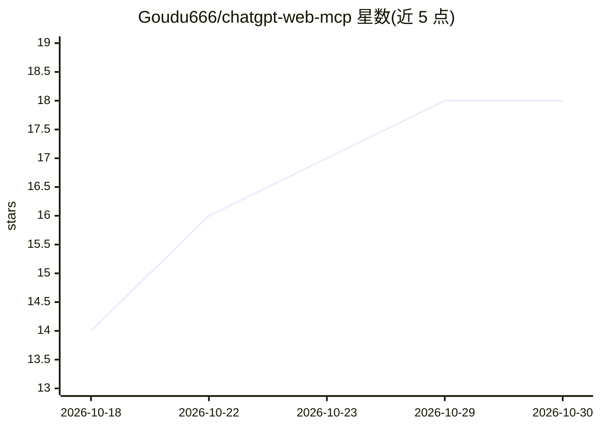

# Goudu666/chatgpt-web-mcp

⭐ 18 · JavaScript · MIT · 推送 2026-09-20 · [GitHub](https://github.com/Goudu666/chatgpt-web-mcp) · 个人维护 · 中文 README

**本地非官方 MCP Server：让 Codex 等客户端经持久浏览器操作 ChatGPT 网页**

一个 Node.js 编写的 stdio MCP Server，使 Codex 等 MCP 客户端通过独立的持久浏览器配置操作 chatgpt.com 网页：发送消息并读取回答、新建/选择对话、上传文件、动态选择模型与思考档位。不使用 OpenAI 付费 API 或 API Key。内置安全节流（默认 5 秒最小间隔）、限流熔断、40 轮对话自动归档轮换，登录资料存于 ~/.chatgpt-web-mcp 与日常浏览器隔离。依赖网页界面，页面改版可能影响可用性。

## 筛选速览

| 维度 | 判定 | 备注 |
|---|---|---|
| AI 角色 | `ai-ecosystem` | LLM/agent 周边工具 |
| 许可风险 | `permissive` | MIT |
| 部署形态 | `None` |  |
| 模型依赖 | — | README 未给出锁定关系 |
| 硬件要求 | — | 无带数字的原话,不猜 |
| 安装摩擦 | `low` | 无编译、无系统依赖或容器化 |
| 成熟度 | — | 结构信号不足 |

## 能力要点

- 通过网页发送消息并读取完整回答，无需 OpenAI API Key
- 跨进程串行操作、低频节流与限流熔断机制
- 40 轮对话自动滚动加载完整 transcript 并归档轮换
- 登录资料使用专用浏览器配置目录，与日常浏览器分离

## 适用场景

- 让 Codex 等 MCP 客户端调用 ChatGPT 网页会话完成任务
- 在没有 API Key 的情况下把 ChatGPT 网页接入 agent 工作流
- 通过 MCP 工具程序化管理 ChatGPT 对话历史与模型档位

## 场景标签

`浏览器自动化` · 领域:效率与自动化

## 证据(README 行号)

> L5: 一个本地、非官方的 MCP Server，让 Codex 等 MCP 客户端通过独立的持久浏览器配置操作 `chatgpt.com`。它不使用 OpenAI 官方付费 API，也不需要 API Key。消息发送通过网页完成；历史读取
> L26: - 支持本地 stdio MCP 的客户端，例如 Codex
> L81: chatgpt-web-mcp serve    启动 stdio MCP Server（默认命令）

## 星数曲线

2026-10-18 14 → 2026-10-30 18（+4）

---
*卡片 v1 · prompt 1.4 · 生成 2026-10-29 · 置信度 high · 依据 README sha `96a442da421b` · [字段定义](../../DATASET.md)*
