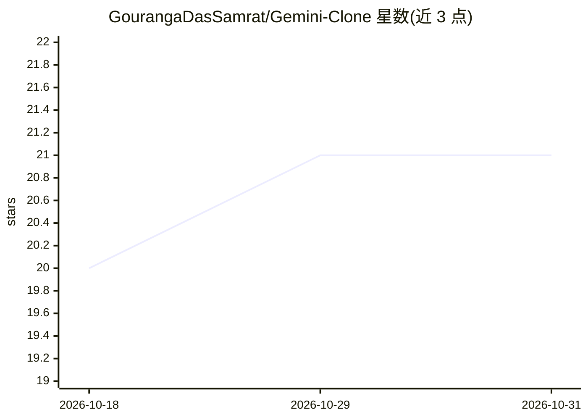

# GourangaDasSamrat/Gemini-Clone

⭐ 21 · JavaScript · MIT · 推送 2025-12-26 · [GitHub](https://github.com/GourangaDasSamrat/Gemini-Clone) · [官网](https://geminiclonebygouranga.netlify.app/) · 个人维护

**网页版 Gemini 聊天界面：HTML/CSS/JS 调用 Gemini API**

纯前端 AI 聊天应用，用 HTML5/CSS3/JavaScript 实现，调用 Google Gemini API 提供对话、代码辅助与内容生成；界面参照 Google Gemini 设计，支持 Markdown 渲染（Marked.js）、代码高亮（Highlight.js），响应式适配多设备。安装方式为 git clone 后直接用浏览器打开 index.html，config.js 中内置演示 API key，生产使用需自行替换；部署到 Netlify。项目声明仅作教育与演示用途，与 Google 无关。

## 筛选速览

| 维度 | 判定 | 备注 |
|---|---|---|
| AI 角色 | `ai-native` | 本体是模型或模型工具 |
| 许可风险 | `permissive` | MIT |
| 部署形态 | `None` |  |
| 模型依赖 | — | README 未给出锁定关系 |
| 硬件要求 | — | 无带数字的原话,不猜 |
| 安装摩擦 | `low` | 无编译、无系统依赖或容器化 |
| 成熟度 | — | 结构信号不足 |

## 能力要点

- 纯前端实现，克隆仓库后浏览器直接打开运行
- 内置演示 API key，生产需在 config.js 替换
- Markdown 渲染与代码高亮（Marked.js/Highlight.js）
- MIT 许可，Netlify 部署

## 适用场景

- 在浏览器中直接体验 Gemini 对话、代码解释与内容生成
- 学习如何用原生 JS 集成 Gemini API
- 作为前端 AI 聊天界面的演示与教学项目

## 场景标签

`聊天机器人` · 领域:对话与助手

## 证据(README 行号)

> L3: ### A Fully Functional AI Chat Application Powered by Google's Gemini
> L30: Welcome to the Gemini AI Chat Application! This is a fully functional AI chat application powered by Google's Gemin

## 星数曲线

2026-10-18 20 → 2026-10-31 21（+1）

---
*卡片 v1 · prompt 1.4 · 生成 2026-10-28 · 置信度 high · 依据 README sha `ac0abdd6ba2b` · [字段定义](../../DATASET.md)*
