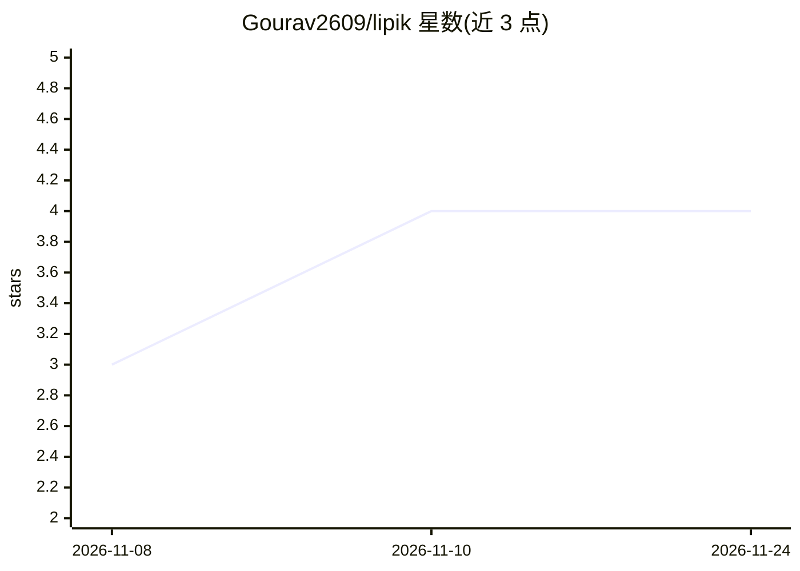

# Gourav2609/lipik

⭐ 4 · Rust · MIT · 推送 2026-11-16 · [GitHub](https://github.com/Gourav2609/lipik) · [官网](https://lipik.refflux.dev) · 个人维护

**Mac 离线语音听写工具：按住 fn 说话即得整理后的文本**

面向 Mac（Apple silicon）用户的免费开源语音听写应用：按住 fn 说话，本地语音模型转写并自动清理口头修正、语气词后，将文本输入当前应用。支持 Whisper/Parakeet 等本地模型、内置本地清理模型、词典与改写快捷键、无机器人入会的会议记录（转写+笔记），并可通过 MCP 让 Claude、Cursor 等 AI 应用只读访问会议笔记。需 macOS 13.3+，会议记录需 14.2+。

## 筛选速览

| 维度 | 判定 | 备注 |
|---|---|---|
| AI 角色 | `ai-native` | 本体是模型或模型工具 |
| 许可风险 | `permissive` | MIT |
| 部署形态 | `desktop` | 安装包/桌面程序 |
| 模型依赖 | local-ok | 支持本地模型 |
| 硬件要求 | — | 无带数字的原话,不猜 |
| 安装摩擦 | `low` | 无编译、无系统依赖或容器化 |
| 成熟度 | `idea` | |

## 能力要点

- 本地语音转写（Whisper、Parakeet 等），模型一次下载后离线运行
- 本地 AI 清理：去除语气词、修正标点，内置 llama.cpp 运行 Qwen3 模型
- 会议记录：录麦克风与系统音频，生成转写与笔记，可经 MCP 提供 AI 应用只读访问
- 支持 Hinglish（罗马字印英混排）与自定义声音微调

## 适用场景

- 在任何 Mac 应用中用语音替代打字
- 整理邮件、消息、代码注释的口述草稿
- 录制会议并生成转写与笔记
- 在 AI 编程工具中查询过往会议内容

## 场景标签

`知识库管理` `语音识别` · 领域:知识与检索

## 证据(README 行号)

> L11: Hold `fn`, speak, and let go. Lipik turns what you said into clean text and
> L24: - **Local speech-to-text.** Choose from Whisper, Parakeet and other models.
> L31: - **Local AI clean-up.** On by default. Built-in rules turn spoken

## 星数曲线

2026-11-08 3 → 2026-11-24 4（+1）

---
*卡片 v1 · prompt 1.4 · 生成 2026-11-21 · 置信度 mid · 依据 README sha `8e9d7bce03b2` · [字段定义](../../DATASET.md)*
