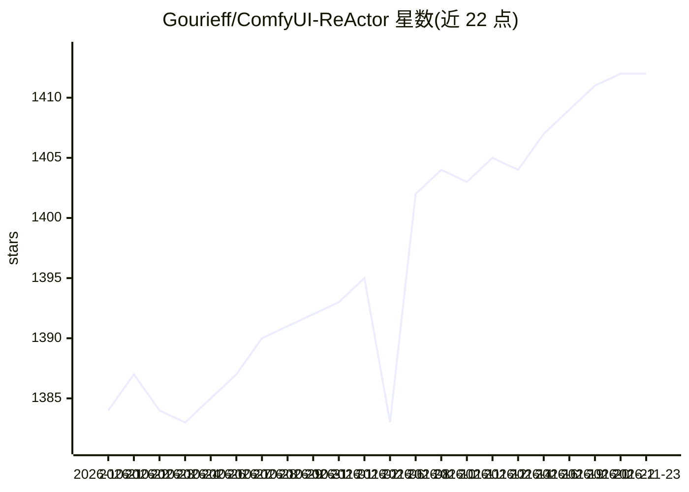

# Gourieff/ComfyUI-ReActor

⭐ 1,412 · Python · GPL-3.0 · 推送 2026-11-14 · [GitHub](https://github.com/Gourieff/ComfyUI-ReActor) · 个人维护

**ComfyUI 换脸扩展节点：提供人脸交换与面部修复**

基于 ReActor 的 ComfyUI 自定义节点集合，核心功能是对图像或视频中的人脸进行交换（face swap），并附带面部修复（GPEN/RestoreFormer/CodeFormer）、人脸模型构建与批量混合、遮罩辅助、人脸相似度检测等节点。0.7.0 起新核心不再依赖 Insightface 与 C++ Build Tools，并内置 NSFW 检测器以规避 18+ 内容。安装方式为通过 ComfyUI Manager 或 git clone 后运行 install.bat/install.py，需从 Hugging Face 等处下载 buffalo_l、inswapper、hyperswap 等模型放入 ComfyUI 模型目录。

## 筛选速览

| 维度 | 判定 | 备注 |
|---|---|---|
| AI 角色 | `ai-native` | 本体是模型或模型工具 |
| 许可风险 | `viral` | GPL-3.0 |
| 部署形态 | `library` | 以包/库形式分发 |
| 模型依赖 | — | README 未给出锁定关系 |
| 硬件要求 | — | 无带数字的原话,不猜 |
| 安装摩擦 | `medium` | 含编译或系统依赖之一 |
| 成熟度 | — | 结构信号不足 |

## 能力要点

- 人脸交换主节点及 Face Boost、Restore Face Advanced、Masking Helper 等配套节点
- 支持 Inswapper/ReSwapper/HyperSwap 多种模型与 safetensors 人脸模型保存
- 内置 NSFW 裸露检测器，定位为 SFW-Friendly 扩展
- 0.7.0 起新核心不依赖 Insightface 与 C++ Build Tools

## 适用场景

- 在 ComfyUI 工作流中对图像或视频做人脸替换
- 对换脸结果做面部修复与清晰度增强
- 批量混合多张人脸生成可复用的人脸模型文件

## 场景标签

`图像生成` · 领域:内容生成

## 证据(README 行号)

> L25: # ReActor Nodes for ComfyUI -=SFW-Friendly=-
> L27: ### The Fast and Simple Face Swap Extension Nodes for ComfyUI, based on blocked ReActor - now it has a nudity detec
> L252:  - (ComfyUI Manager) Open ComfyUI Manager, click "Install Custom Nodes", type "ReActor" in the "Search" field and 

## 星数曲线

2026-10-21 1,384 → 2026-11-23 1,412（+28）

---
*卡片 v1 · prompt 1.4 · 生成 2026-11-23 · 置信度 mid · 依据 README sha `9e8f491140ac` · [字段定义](../../DATASET.md)*
