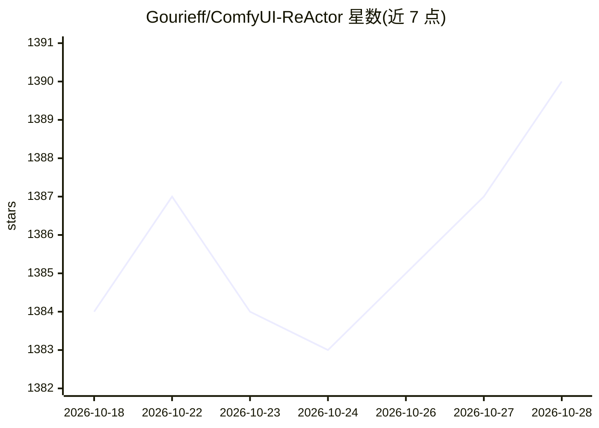

# Gourieff/ComfyUI-ReActor

⭐ 1,391 · Python · GPL-3.0 · 推送 2026-10-24 · [GitHub](https://github.com/Gourieff/ComfyUI-ReActor) · 个人维护

**ComfyUI 的换脸扩展节点集，含 SFW 内容检测**

面向 ComfyUI 用户的换脸自定义节点扩展：基于新的 ReActor Core（0.7.0 起不再依赖 Insightface 与 C++ Build Tools），在图像或视频帧上将源人脸替换到目标图像，内置 NSFW 检测器以拒绝 18+ 内容。提供人脸修复、人脸模型构建/混合/保存、面部遮罩、换脸强度与相似度检查等约 15 个节点，支持 Inswapper/ReSwapper/HyperSwap 等多种换脸模型及 GFPGAN/GPEN 等修复模型，可从 Hugging Face 数据集下载模型。通过 ComfyUI Manager 或 git clone 加 install.bat 安装，需手动放置模型文件。

## 筛选速览

| 维度 | 判定 | 备注 |
|---|---|---|
| AI 角色 | `ai-native` | 本体是模型或模型工具 |
| 许可风险 | `viral` | GPL-3.0 |
| 部署形态 | `library` | 以包/库形式分发 |
| 模型依赖 | — | README 未给出锁定关系 |
| 硬件要求 | — | 无带数字的原话,不猜 |
| 安装摩擦 | `medium` | 含编译或系统依赖之一 |
| 成熟度 | `idea` | |

## 能力要点

- 0.7.0 起的新 ReActor Core 不再依赖 Insightface 与 C++ Build Tools
- 内置 NSFW 检测器，拒绝 18+ 内容（SFW 定位）
- 支持 Inswapper/ReSwapper/HyperSwap 换脸模型与多种人脸修复模型
- 可构建、混合、保存人脸模型（safetensors）供复用

## 适用场景

- 在 ComfyUI 工作流中对图片或视频帧做人脸替换
- 从多张照片混合生成人脸模型以提升相似度
- 换脸后做人脸修复与相似度检查

## 场景标签

`图像生成` · 领域:内容生成

## 证据(README 行号)

> L25: # ReActor Nodes for ComfyUI -=SFW-Friendly=-
> L27: ### The Fast and Simple Face Swap Extension Nodes for ComfyUI, based on blocked ReActor - now it has a nudity detec

## 星数曲线

2026-10-18 1,384 → 2026-10-28 1,390（+6）

---
*卡片 v1 · prompt 1.4 · 生成 2026-10-21 · 置信度 mid · 依据 README sha `59820eff838e` · [字段定义](../../DATASET.md)*
