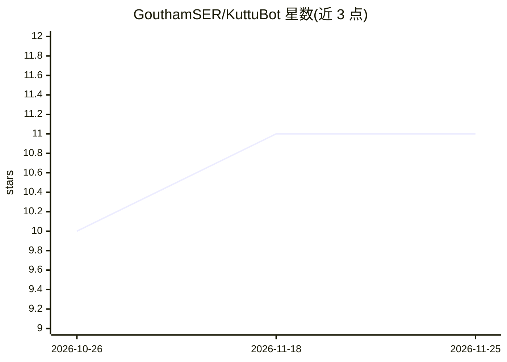

# GouthamSER/KuttuBot

⭐ 11 · Python · GPL-2.0 · 推送 2026-11-08 · [GitHub](https://github.com/GouthamSER/KuttuBot) · [官网](https://gouthamjosh.vercel.app/) · 个人维护

**Telegram 群组的文件自动过滤与检索分发机器人**

基于 Pyrogram 的 Telegram 自动过滤机器人：索引指定频道中的文件存入 MongoDB，用户在群内发送关键词即可返回对应文件，支持手动过滤、内联搜索、拼写建议、语言与画质筛选。附带 Telegram Mini App 海报浏览界面与公开电影网站（短时效 token 分发文件），支持文件自动删除、强制订阅、封禁管理、广播与统计数据。配置依赖 BotFather token、MongoDB 与日志频道，提供 Koyeb/Scalingo/Heroku/Docker/VPS 部署方式。

## 筛选速览

| 维度 | 判定 | 备注 |
|---|---|---|
| AI 角色 | `ai-enhanced` | 去掉 AI 部分产品仍成立 |
| 许可风险 | `viral` | GPL-2.0 |
| 部署形态 | `self-host` | docker 或自建部署 |
| 模型依赖 | — | README 未给出锁定关系 |
| 硬件要求 | — | 无带数字的原话,不猜 |
| 安装摩擦 | `low` | 无编译、无系统依赖或容器化 |
| 成熟度 | — | 结构信号不足 |

## 能力要点

- 频道文件索引 + 关键词自动过滤，结果存取 MongoDB
- Telegram Mini App 海报界面与公开网站分发（短 token + 自动过期）
- imdbio→OMDb→TMDB 海报与影片信息链，拼写纠正建议
- 文件自动删除、强制订阅、封禁、广播等群管理功能

## 适用场景

- 在 Telegram 群里按关键词检索并获取已索引的影视文件
- 搭建带海报浏览网页和 Mini App 的文件分享频道
- 管理多群组的过滤规则、订阅校验与用户封禁

## 场景标签

 · 领域:即时通讯机器人/文件分享工具

## 证据(README 行号)

> L5:  A powerful Telegram auto-filter bot built with Pyrogram
> L30: |Spelling Check & Suggestions|✅|

## 星数曲线

2026-10-26 10 → 2026-11-25 11（+1）

---
*卡片 v1 · prompt 1.4 · 生成 2026-11-19 · 置信度 low · 依据 README sha `82f16b9cdd07` · [字段定义](../../DATASET.md)*
