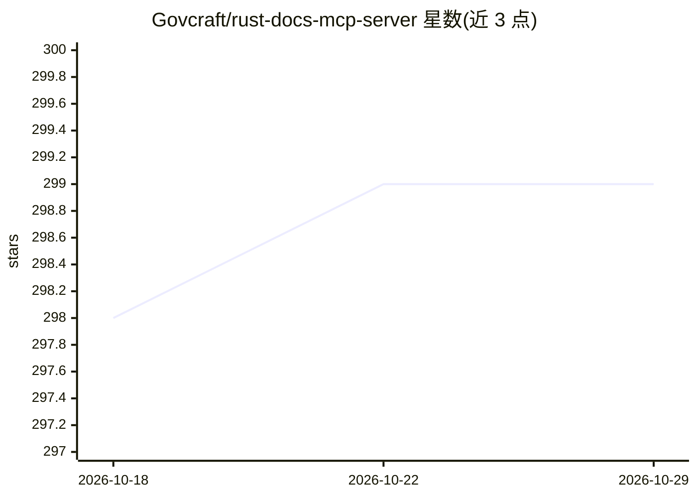

# Govcraft/rust-docs-mcp-server

⭐ 299 · Rust · MIT · 推送 2025-11-24 · [GitHub](https://github.com/Govcraft/rust-docs-mcp-server) · 个人维护

**为 Rust crate 提供实时文档问答的 MCP 服务器，供 AI 编码助手调用**

面向使用 Cursor、Roo Code、Claude Desktop 等 AI 编码助手的 Rust 开发者的 MCP 服务器：每个实例针对一个 crate，首次运行时通过 cargo doc 生成文档、解析 HTML、调用 OpenAI text-embedding-3-small 生成嵌入并缓存；运行期暴露 query_rust_docs 工具，以余弦相似度检索最相关文档片段，再由 gpt-4o-mini 仅基于该上下文生成回答，缓解训练截止导致的过时代码建议。需要 OPENAI_API_KEY 与网络访问，首次嵌入生成耗时并产生少量费用；可多实例并发覆盖多个 crate。安装提供预编译二进制或 cargo build 源码构建。

## 筛选速览

| 维度 | 判定 | 备注 |
|---|---|---|
| AI 角色 | `ai-ecosystem` | LLM/agent 周边工具 |
| 许可风险 | `permissive` | MIT |
| 部署形态 | `desktop` | 安装包/桌面程序 |
| 模型依赖 | — | README 未给出锁定关系 |
| 硬件要求 | — | 无带数字的原话,不猜 |
| 安装摩擦 | `medium` | 含编译或系统依赖之一 |
| 成熟度 | — | 结构信号不足 |

## 能力要点

- 单实例绑定一个 Rust crate，支持按版本与 feature 指定文档生成
- 嵌入+余弦相似度检索，LLM 仅基于检索上下文作答
- 文档与嵌入按 crate/版本/feature 组合缓存于 XDG 数据目录，后续启动免重复计费
- 标准 MCP over stdio，可在 Roo Code / Claude Desktop 中多实例配置

## 适用场景

- 在 Cursor/Roo Code 中写 Rust 时让助手查询 crate 最新 API 文档
- 为更新频繁的 crate（serde/tokio/reqwest 等）避免过时代码建议
- 同一编码会话中并发运行多实例覆盖多个 crate 文档

## 场景标签

`文档问答` · 领域:知识与检索

## 证据(README 行号)

> L18: This MCP server addresses this challenge by providing a focused, up-to-date
> L21: assistant a tool (`query_rust_docs`) it can use _before_ writing code related to
> L52: - **MCP Integration:** Runs as a standard MCP server over stdio, exposing tools

## 星数曲线

2026-10-18 298 → 2026-10-29 299（+1）

---
*卡片 v1 · prompt 1.4 · 生成 2026-10-21 · 置信度 high · 依据 README sha `512d11a43cd9` · [字段定义](../../DATASET.md)*
