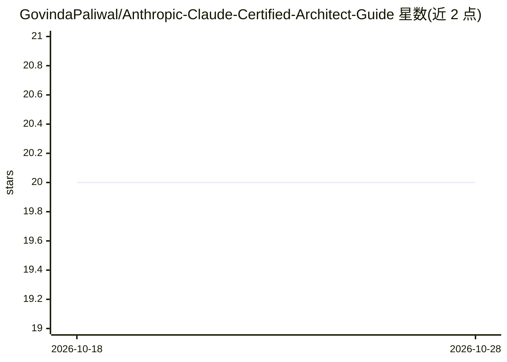

# GovindaPaliwal/Anthropic-Claude-Certified-Architect-Guide

⭐ 20 · 推送 2026-04-03 · [GitHub](https://github.com/GovindaPaliwal/Anthropic-Claude-Certified-Architect-Guide) · [官网](https://medium.com/p/741a806eb94c) · 个人维护

**Anthropic 认证架构师考试 2026 备考学习指南**

面向开发者、AI 学习者与解决方案架构师的备考知识仓库：整理 Anthropic Certified Architect Exam 的预期考试格式、5 个考试域权重、6 类真实考题场景，并提供 8 大核心主题的学习笔记（Claude API、Prompt 工程、结构化输出、Claude Code、Agent SDK、MCP、上下文管理、可靠性安全评测）与 5 周学习计划。内容为 Markdown 文档形式，附带一篇 Medium 博客链接作为延伸阅读；仓库不含可运行代码。

## 筛选速览

| 维度 | 判定 | 备注 |
|---|---|---|
| AI 角色 | `ai-knowledge` | 知识聚合/清单类 |
| 许可风险 | `none` | — |
| 部署形态 | `None` |  |
| 模型依赖 | — | README 未给出锁定关系 |
| 硬件要求 | — | 无带数字的原话,不猜 |
| 安装摩擦 | `low` | 无编译、无系统依赖或容器化 |
| 成熟度 | — | 结构信号不足 |

## 能力要点

- 预期考试格式与 5 个考试域权重说明
- 6 类真实考题场景（客服 agent、代码生成、多 agent 研究等）
- 8 大核心主题的详细学习笔记
- 5 周分阶段学习计划与常见备考误区

## 适用场景

- 我准备参加 Anthropic 认证架构师考试，需要系统的复习资料
- 我想了解 Claude 生态（Claude Code、Agent SDK、MCP）的核心概念
- 我需要一份按周组织的备考计划

## 场景标签

`教程课程` · 领域:学习与行业

## 证据(README 行号)

> L1: # Anthropic Certified Architect Exam 2026
> L103: The exam mainly focuses on these **5 domains**:
> L562: # 📅 Best 5-Week Study Plan

## 星数曲线

2026-10-18 20 → 2026-10-28 20（+0）

---
*卡片 v1 · prompt 1.4 · 生成 2026-10-28 · 置信度 high · 依据 README sha `70654195ee74` · [字段定义](../../DATASET.md)*
