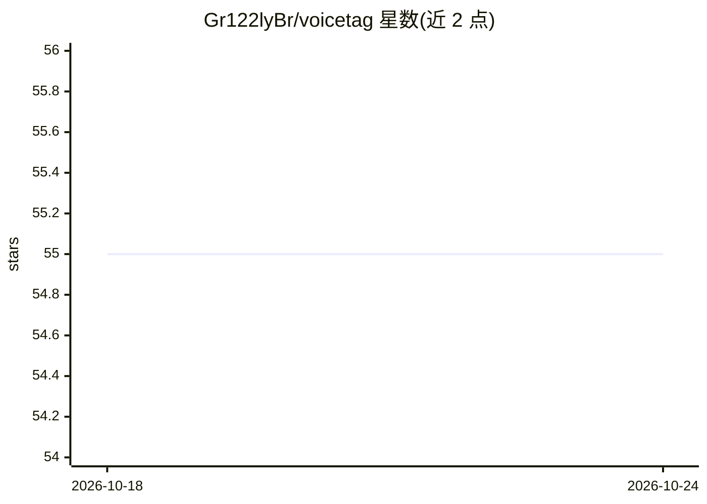

# Gr122lyBr/voicetag

⭐ 55 · Python · MIT · 推送 2026-03-16 · [GitHub](https://github.com/Gr122lyBr/voicetag) · 个人维护

**给开发者的说话人分离与具名识别 Python 库**

Python 库，结合 pyannote.audio 做说话人分离、resemblyzer 计算语音嵌入，通过注册样本建立说话人档案并以余弦相似度匹配，输出带置信度的时间线；内置重叠语音检测与并行嵌入计算。转录功能可接入 OpenAI、Groq、Fireworks、本地 Whisper 或 Deepgram 以产出‘谁说了什么’。提供三行代码的 API 与完整 CLI，结果为 Pydantic 类型化模型。需接受 pyannote 模型的 HuggingFace 许可并配置 token；GPU 加速（CUDA/MPS）为可选项。

## 筛选速览

| 维度 | 判定 | 备注 |
|---|---|---|
| AI 角色 | `ai-native` | 本体是模型或模型工具 |
| 许可风险 | `permissive` | MIT |
| 部署形态 | `library` | 以包/库形式分发 |
| 模型依赖 | locked-api |  |
| 硬件要求 | — | 无带数字的原话,不猜 |
| 安装摩擦 | `medium` | 含编译或系统依赖之一 |
| 成熟度 | — | 结构信号不足 |

## 能力要点

- 注册说话人档案 + 余弦相似度匹配，输出带置信度的具名时间线
- 内置重叠语音检测与并行嵌入计算（可配置线程池）
- 转录可选 OpenAI/Groq/Fireworks/本地 Whisper/Deepgram 后端
- 提供 CLI 与 Pydantic 类型化结果模型

## 适用场景

- 给播客/访谈录音标注主持人与嘉宾分段
- 会议录音中区分谁说了什么并生成按人摘要
- 呼叫中心录音区分坐席与客户用于质检

## 场景标签

`语音识别` · 领域:感知与多模态

## 证据(README 行号)

> L15: voicetag is a Python library for **speaker diarization and named speaker identification**. It combines pyannote.aud
> L289: 1. **Diarize** -- pyannote.audio segments the audio into speaker turns with anonymous labels (`SPEAKER_00`, `SPEAK
> L291: 3. **Match** -- each embedding is compared against enrolled speaker profiles using cosine similarity. Matches abov

## 星数曲线

2026-10-18 55 → 2026-10-24 55（+0）

---
*卡片 v1 · prompt 1.4 · 生成 2026-10-24 · 置信度 high · 依据 README sha `beb045cc8c10` · [字段定义](../../DATASET.md)*
