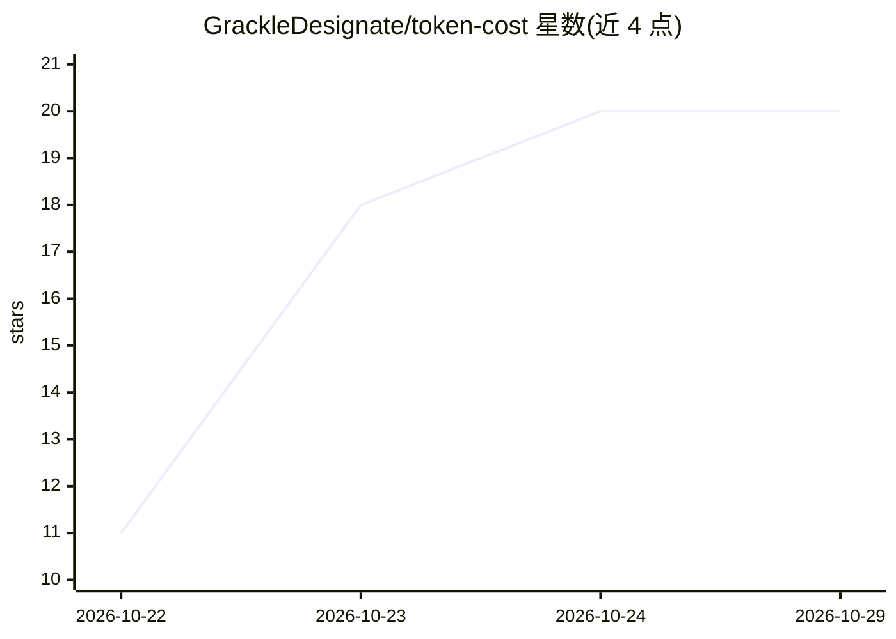

# GrackleDesignate/token-cost

⭐ 20 · C# · MIT · 推送 2026-10-18 · [GitHub](https://github.com/GrackleDesignate/token-cost) · 个人维护

**离线 LLM API 成本计算器：跨模型比价、模拟对话、预算追踪**

面向 Windows 的桌面计算器（.NET 8 自包含 exe，约 100 MB，免安装离线运行）：内置主流托管模型每百万 token 费率表（可编辑），支持粘贴文本统计 token 数并按各模型计价、按轮次与上下文增长模拟对话估算月账单、CSV 批量对比 20 个模型定价、设置月度预算上限并导出报价表。价格为静态费率表估算，不读取真实账单。需自行用 .NET 8 SDK 构建或下载安装包（README 附压缩包密码）。

## 筛选速览

| 维度 | 判定 | 备注 |
|---|---|---|
| AI 角色 | `ai-ecosystem` | LLM/agent 周边工具 |
| 许可风险 | `permissive` | MIT |
| 部署形态 | `None` |  |
| 模型依赖 | — | README 未给出锁定关系 |
| 硬件要求 | — | 无带数字的原话,不猜 |
| 安装摩擦 | `medium` | 含编译或系统依赖之一 |
| 成熟度 | — | 结构信号不足 |

## 能力要点

- 内置可编辑的主流模型每百万 token 费率表
- 对话模拟器按轮次与上下文增长估算月费用
- CSV 批量对比约 20 个模型定价
- 100 MB 自包含 exe，离线运行，无广告无遥测

## 适用场景

- 上线前按模型比价并预估月度 API 开销
- 把计划中的提示词批量导入做成本测算
- 向内部审批流程导出费用报价表

## 场景标签

 · 领域:LLM API 成本管理

## 证据(README 行号)

> L3: 💰 Free, open-source API cost calculator for Windows — compare token prices across models, plan budgets offline. 100 
> L14: - ✅ **Batch comparison** — a CSV of planned prompts priced across twenty models side by side

## 星数曲线

2026-10-22 11 → 2026-10-29 20（+9）

---
*卡片 v1 · prompt 1.4 · 生成 2026-10-28 · 置信度 mid · 依据 README sha `e5e21e52e0ba` · [字段定义](../../DATASET.md)*
