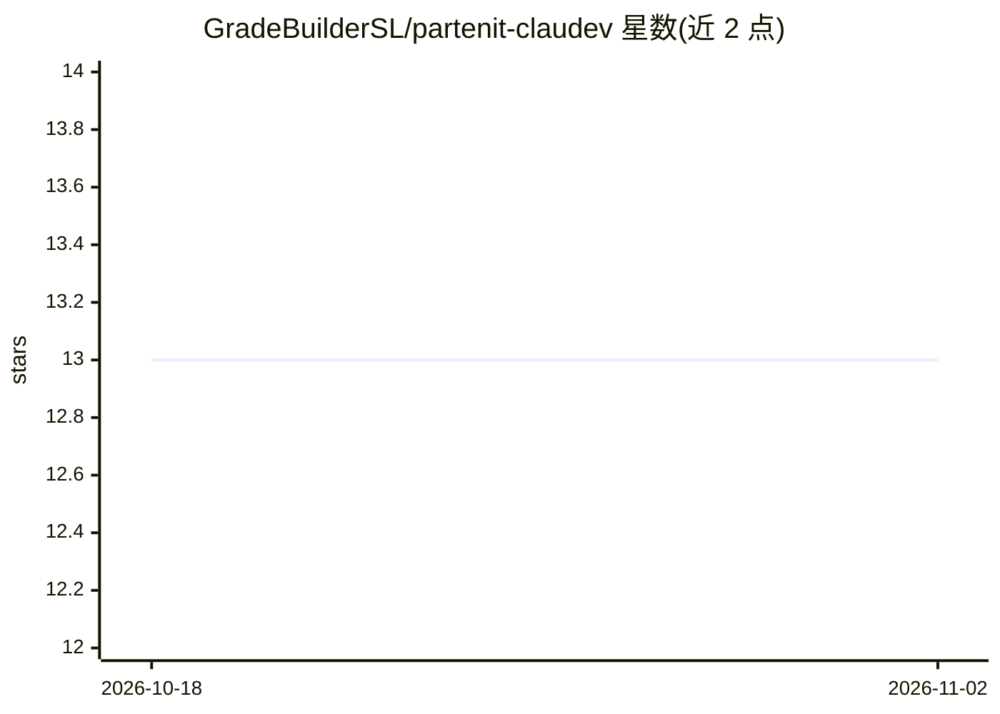

# GradeBuilderSL/partenit-claudev

⭐ 13 · Python · MIT · 推送 2026-03-19 · [GitHub](https://github.com/GradeBuilderSL/partenit-claudev) · [官网](https://partenit.io/) · 组织维护

**Jira 任务驱动的全自动 AI 开发流水线：任务→代码→PR→自动合并**

由 Jira 状态变更触发的 4 阶段自动化开发流水线：任务移入 In Progress 后，系统调用 Claude Code CLI 完成系统分析、架构设计、写代码与测试并自动开 PR，移至 Ready to Merge 即自动合并。智力工作由 Claude Code（Max 订阅认证）承担，另有可配置的轻量编排 LLM（任意 OpenAI 兼容 API）负责解析 Jira 描述、分类与总结。支持 PLAN 前缀将功能拆解为史诗与子任务，提供 Telegram 机器人通知与命令、Railway/Docker 部署、并发队列与限流重试。需配置 Jira webhook、GitHub token 与指定的工作流状态名。

## 筛选速览

| 维度 | 判定 | 备注 |
|---|---|---|
| AI 角色 | `ai-native` | 本体是模型或模型工具 |
| 许可风险 | `permissive` | MIT |
| 部署形态 | `self-host` | docker 或自建部署 |
| 模型依赖 | local-ok | 支持本地模型 |
| 硬件要求 | — | 无带数字的原话,不猜 |
| 安装摩擦 | `low` | 无编译、无系统依赖或容器化 |
| 成熟度 | — | 结构信号不足 |

## 能力要点

- Jira 状态触发：In Progress 启动开发，Ready to Merge 自动合并
- PLAN: 前缀触发规划流水线，Claude Code 读代码库并生成结构化任务拆解
- 编排 LLM 可用任意 OpenAI 兼容 API（DeepSeek/Groq/Ollama 等），每轮约 $0.01-0.05
- Telegram 机器人支持 /new /plan /cancel /status 等命令与重试通知

## 适用场景

- 把 Jira 任务接入自动代码生成与 PR 流程
- 在开发前让 AI 读取代码库做功能拆解与任务规划
- 通过 Telegram 远程创建任务、取消流水线、查看进度

## 场景标签

`工作流自动化` `编码 Agent` · 领域:效率与自动化

## 证据(README 行号)

> L5:  Jira task → Claude Code → GitHub PR → auto-merge → Done
> L14: Move a Jira task to **In Progress** and the pipeline takes over: creates subtasks, runs system analysis and archite
> L31: |**Claude Code** (Max subscription)|All intellectual work: analysis, architecture, code, tests|Included in Max sub|

## 星数曲线

2026-10-18 13 → 2026-11-02 13（+0）

---
*卡片 v1 · prompt 1.4 · 生成 2026-10-31 · 置信度 mid · 依据 README sha `d055777e1e27` · [字段定义](../../DATASET.md)*
