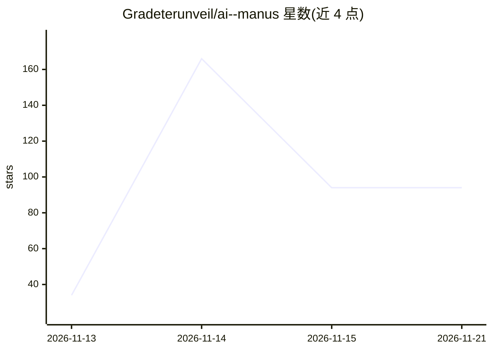

# Gradeterunveil/ai--manus

⭐ 94 · Apache-2.0 · 推送 2026-11-15 · [GitHub](https://github.com/Gradeterunveil/ai--manus) · 个人维护

**面向日常任务的自主 AI Agent：代用户执行代码与浏览器操作**

Manus 是一个自主 AI Agent，定位为家用/学习/轻办公场景的个人助手：自主编写并执行脚本、控制浏览器（导航网页、填写表单、抓取信息），并执行多步骤任务。用户以自然指令委派任务，Agent 自行规划步骤，可在脚本与浏览器操作间衔接完成流程。README 说明其为小规模场景设计，非企业平台。页面含下载码 PROMO2026，但未提供具体安装命令、代码结构或技术实现细节。

## 筛选速览

| 维度 | 判定 | 备注 |
|---|---|---|
| AI 角色 | `ai-native` | 本体是模型或模型工具 |
| 许可风险 | `permissive` | Apache-2.0 |
| 部署形态 | `None` |  |
| 模型依赖 | — | README 未给出锁定关系 |
| 硬件要求 | — | 无带数字的原话,不猜 |
| 安装摩擦 | `low` | 无编译、无系统依赖或容器化 |
| 成熟度 | — | 结构信号不足 |

## 能力要点

- 自主执行代码与脚本（autonomous code execution）
- 浏览器控制：导航、填表、信息采集
- 代码与浏览器操作在同一任务流中衔接
- 面向小规模场景：家庭、学习、轻办公

## 适用场景

- 让 Agent 代为完成网页查资料、填表单等重复操作
- 委派小型脚本编写与运行任务
- 整理研究笔记、多页信息汇总等日常杂务

## 场景标签

`AI 助手` `浏览器自动化` `编码 Agent` · 领域:效率与自动化

## 证据(README 行号)

> L10: - **Autonomous Code Execution:** Manus AI agent runs code on its own to complete tasks, so you can focus on decisio
> L18: Manus is an autonomous AI agent designed to run code and control a browser on your behalf. Instead of acting like a

## 星数曲线

2026-11-13 34 → 2026-11-21 94（+60）

---
*卡片 v1 · prompt 1.4 · 生成 2026-11-17 · 置信度 mid · 依据 README sha `0f78ee3a5dd2` · [字段定义](../../DATASET.md)*
