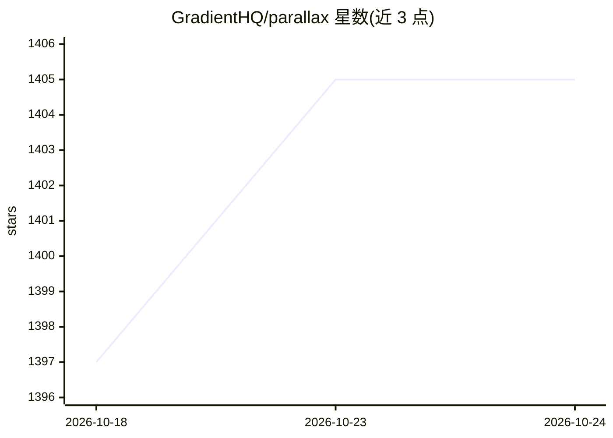

# GradientHQ/parallax

⭐ 1,405 · Python · Apache-2.0 · 推送 2026-07-01 · [GitHub](https://github.com/GradientHQ/parallax) · 组织维护

**分布式 LLM 推理引擎：跨设备组建集群共享 GPU 托管模型**

Gradient 开发的去中心化模型推理框架，可将物理位置与配置各异的分布式节点组成 AI 集群进行 LLM 推理。核心机制：P2P 通信基于 Lattica，GPU 后端使用 SGLang 与 vLLM，Mac 后端使用 MLX LM；支持流水线并行模型分片、Paged KV cache 与 Mac 上的连续批处理、动态请求调度路由。通过 git clone 加 install.sh 脚本安装，可托管 DeepSeek、GLM、Kimi、Qwen 等开源模型；README 标注版本为 0.0.1 起步阶段。

## 筛选速览

| 维度 | 判定 | 备注 |
|---|---|---|
| AI 角色 | `ai-ecosystem` | LLM/agent 周边工具 |
| 许可风险 | `permissive` | Apache-2.0 |
| 部署形态 | `None` |  |
| 模型依赖 | local-ok | 支持本地模型 |
| 硬件要求 | — | 无带数字的原话,不猜 |
| 安装摩擦 | `low` | 无编译、无系统依赖或容器化 |
| 成熟度 | — | 结构信号不足 |

## 能力要点

- 跨平台分布式节点组建推理集群，个人设备可托管本地 LLM
- 流水线并行模型分片与 Paged KV cache 管理
- GPU 后端（SGLang/vLLM）与 Mac 后端（MLX LM）双路线
- 支持 OpenClaw 集成

## 适用场景

- 把多台异地机器组网成统一 LLM 推理集群
- 在 Mac 等个人设备上托管并共享本地模型
- 为 DeepSeek/GLM/Kimi/Qwen 等开源模型提供分布式服务

## 场景标签

`推理引擎` · 领域:训练与推理

## 证据(README 行号)

> L29: A fully decentralized inference engine developed by Gradient. Parallax lets you build your own AI cluster for model
> L40: * GPU backend powered by SGLang and vLLM

## 星数曲线

2026-10-18 1,397 → 2026-10-24 1,405（+8）

---
*卡片 v1 · prompt 1.4 · 生成 2026-10-21 · 置信度 high · 依据 README sha `38d6b001eae4` · [字段定义](../../DATASET.md)*
