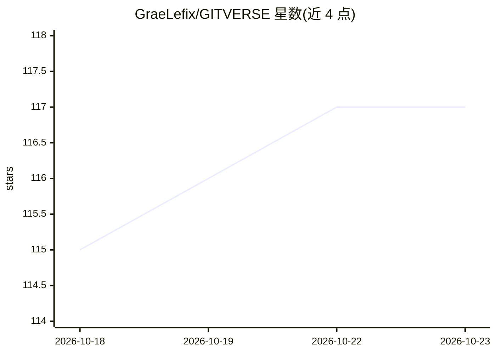

# GraeLefix/GITVERSE

⭐ 117 · TypeScript · MIT · 推送 2026-06-25 · [GitHub](https://github.com/GraeLefix/GITVERSE) · [官网](http://gitverse.id/) · 个人维护

**把任意代码库逆向为 AI 重建提示词的 Web 工具**

基于 Next.js 16 + TypeScript 的 Web 应用：粘贴代码文件或 GitHub 公开仓库 URL，由 LLM 分析技术栈、架构、依赖、API 与业务逻辑，生成含 ASCII 架构图、逐文件内容、依赖与环境变量的复制即用重建提示词，供 Cursor、Claude Code、Codex 等 AI 编码代理使用。支持 Grok/OpenRouter/Azure OpenAI/Google AI Studio 四个 LLM 提供商（至少配一个 API key），含增量批量模式；Supabase 与 Stripe 为可选组件。代码不在服务器永久存储。

## 筛选速览

| 维度 | 判定 | 备注 |
|---|---|---|
| AI 角色 | `ai-native` | 本体是模型或模型工具 |
| 许可风险 | `permissive` | MIT |
| 部署形态 | `library` | 以包/库形式分发 |
| 模型依赖 | locked-api |  |
| 硬件要求 | — | 无带数字的原话,不猜 |
| 安装摩擦 | `low` | 无编译、无系统依赖或容器化 |
| 成熟度 | — | 结构信号不足 |

## 能力要点

- 粘贴代码或 GitHub URL 生成完整重建提示词
- ASCII 架构图展示组件与数据流
- 多 LLM 支持：Grok、OpenRouter、Azure OpenAI、Google AI Studio，auto 模式自动降级
- 增量模式：多文件粘贴后输入 GITVERSE_DONE 批量分析

## 适用场景

- 我想把现有仓库转成提示词，让 Cursor/Claude Code 重建项目
- 通过粘贴代码文件快速理解陌生代码库的结构
- 批量粘贴多个文件后一次性生成完整构建提示词

## 场景标签

`提示工程` · 领域:Agent 开发

## 证据(README 行号)

> L15: **GITVERSE** is an AI-powered reverse engineering tool that turns any codebase into a structured build prompt you c
> L26: 2. **AI analyzes** — full breakdown of architecture, dependencies, APIs, and business logic
> L27: 3. **Get prompt** — one exhaustive, copy-paste-ready reconstruction prompt

## 星数曲线

2026-10-18 115 → 2026-10-23 117（+2）

---
*卡片 v1 · prompt 1.4 · 生成 2026-10-23 · 置信度 mid · 依据 README sha `919c357a36b8` · [字段定义](../../DATASET.md)*
