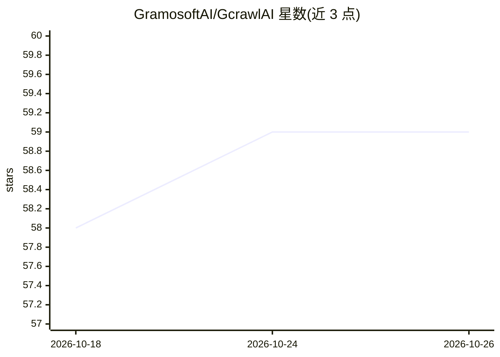

# GramosoftAI/GcrawlAI

⭐ 59 · Python · MIT · 推送 2026-08-27 · [GitHub](https://github.com/GramosoftAI/GcrawlAI) · [官网](https://gcrawlai.com) · 组织维护

**面向 RAG/LLM 数据管线的分布式爬虫与抽取平台**

Gramosoft 维护的开源分布式网页爬取与抽取平台，用于向 RAG 管线、LLM 与语义搜索索引供给数据。基于 FastAPI + Celery + Redis + PostgreSQL + Playwright 架构，提供隐身浏览器指纹伪装、分级住宅代理轮换、整页截图、SEO 元数据抽取、离线 HTML 打包与 Fit-Markdown 输出，另有 pip 安装的 Python SDK 与付费闭源的专业站点抽取器（Amazon/Flipkart/Walmart 等）。自部署需 Python 3.9+、PostgreSQL、Redis，并启动 Redis、Celery worker、FastAPI 与 Angular 前端四个进程。

## 筛选速览

| 维度 | 判定 | 备注 |
|---|---|---|
| AI 角色 | `ai-ecosystem` | LLM/agent 周边工具 |
| 许可风险 | `permissive` | MIT |
| 部署形态 | `library` | 以包/库形式分发 |
| 模型依赖 | — | README 未给出锁定关系 |
| 硬件要求 | — | 无带数字的原话,不猜 |
| 安装摩擦 | `low` | 无编译、无系统依赖或容器化 |
| 成熟度 | — | 结构信号不足 |

## 能力要点

- 隐身浏览与指纹伪装、分级住宅代理轮换（地理定向）
- Celery + Redis 分布式并行爬取，实时任务进度查询 API
- Fit-Markdown 输出：剪除导航/页脚/广告等样板，产出 LLM 就绪文本
- 官方 Python SDK（pip install gcrawl-sdk）覆盖 scrape/crawl/links/screenshot/search 端点

## 适用场景

- 为 RAG 或语义搜索引擎批量构建网站知识语料
- 绕过反爬限制抓取登录态或受保护站点（浏览器扩展同步 Cookie）
- 通过 SDK 以编程方式获取单页 Markdown/截图/SEO 数据

## 场景标签

`网页抓取` `文档解析` · 领域:效率与自动化

## 证据(README 行号)

> L28: **GcrawlAI** is a high-performance, enterprise-grade, distributed web crawler, scraper, and extraction platform. De
> L30: GcrawlAI automates browser steering, stealth obfuscation, anti-bot evasion, and distributed scaling so that you can

## 星数曲线

2026-10-18 58 → 2026-10-26 59（+1）

---
*卡片 v1 · prompt 1.4 · 生成 2026-10-24 · 置信度 high · 依据 README sha `cc41cfa0f234` · [字段定义](../../DATASET.md)*
