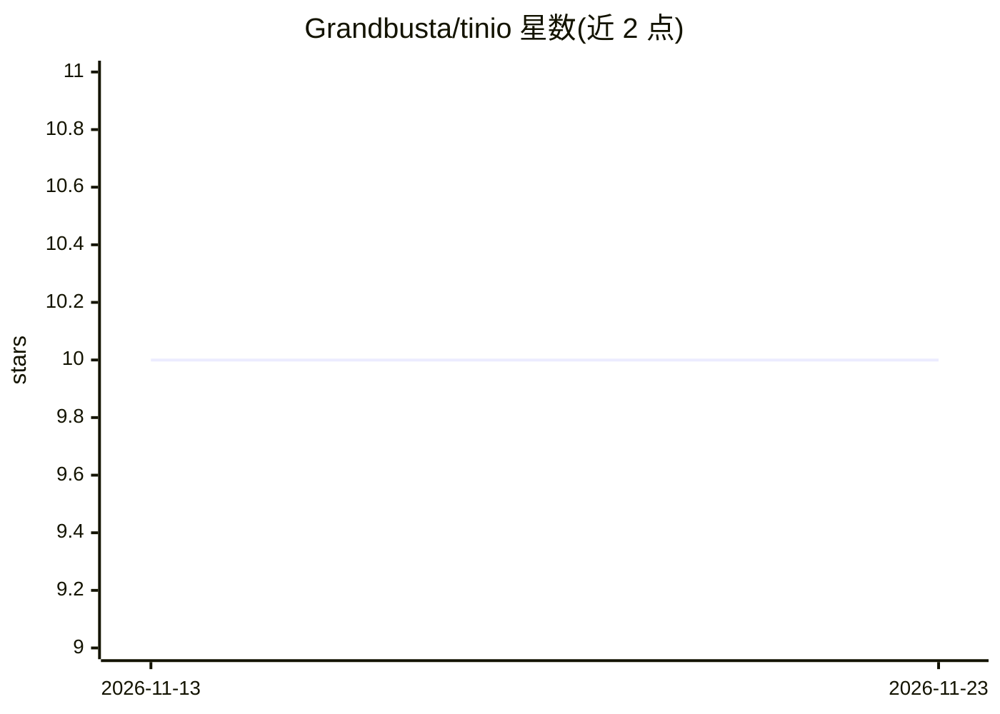

# Grandbusta/tinio

⭐ 10 · Go · MIT · 推送 2026-11-21 · [GitHub](https://github.com/Grandbusta/tinio) · 个人维护

**给个人用户的 Telegram 常驻人格 agent：自主规划日常并做事**

以 Go 编写的单机 agent 框架：用户选择或自写角色（character.yaml/work.yaml/judgment.yaml），agent 在 Telegram 上与用户对话，每天生成计划并执行写作、笔记、读书/网页笔记、生成 PDF/Word/表格/MIDI 等产出。依赖 OpenAI API key 与 Postgres（可用 Docker 启动），带预算上限（budget_usd）、auto/ask/forbid 审批机制、Agent Skills 技能加载、MCP 工具接入、本地 mind console 查看记忆与决策。MIT 许可。

## 筛选速览

| 维度 | 判定 | 备注 |
|---|---|---|
| AI 角色 | `ai-native` | 本体是模型或模型工具 |
| 许可风险 | `permissive` | MIT |
| 部署形态 | `library` | 以包/库形式分发 |
| 模型依赖 | — | README 未给出锁定关系 |
| 硬件要求 | — | 无带数字的原话,不猜 |
| 安装摩擦 | `low` | 无编译、无系统依赖或容器化 |
| 成熟度 | — | 结构信号不足 |

## 能力要点

- 五套预置角色或自写三文件角色定义
- 每日计划-执行-日志-周回顾的自主循环（可 pace 加速）
- auto/ask/forbid 三级审批，触达他人默认需 Telegram 批准
- Agent Skills（SKILL.md）教学与 MCP 服务器工具接入

## 适用场景

- 让一个有人格的 agent 每天替我做写作、读书笔记等产出
- 在 Telegram 上随时和自己的 agent 沟通并审批其对外动作
- 用技能文件夹教 agent 我的写作规范或工作流程

## 场景标签

`Agent 框架` `AI 助手` · 领域:Agent 开发

## 证据(README 行号)

> L5: Tinio gives you an agent with character, not a blank prompt. Pick one of five ready
> L8: journal and get better at what they do. They talk with you on Telegram, keep their
> L18: - **Initiative.** A plan each morning, work done before you ask, promises kept on time.

## 星数曲线

2026-11-13 10 → 2026-11-23 10（+0）

---
*卡片 v1 · prompt 1.4 · 生成 2026-11-20 · 置信度 high · 依据 README sha `04cb77364c81` · [字段定义](../../DATASET.md)*
