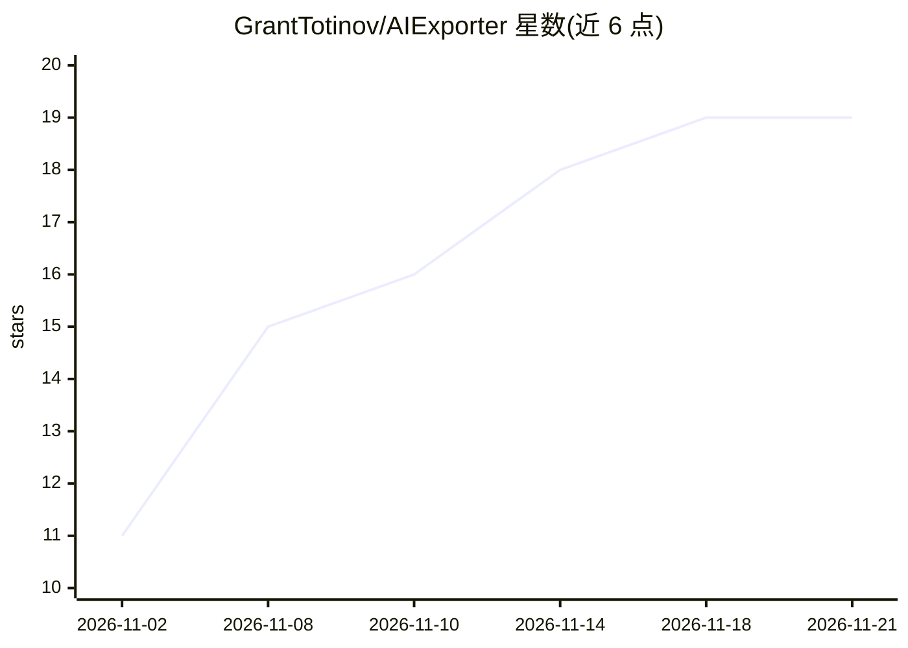

# GrantTotinov/AIExporter

⭐ 19 · TypeScript · NOASSERTION · 推送 2026-11-09 · [GitHub](https://github.com/GrantTotinov/AIExporter) · [官网](https://granttotinov.github.io/AIExporter/) · 个人维护 · 中文 README

**浏览器扩展：将 15 个 AI 聊天站点的对话导出为多种格式文件**

支持 Chrome/Edge/Firefox 的免费浏览器扩展，把 ChatGPT、Claude、Gemini、DeepSeek、Grok、Perplexity、Copilot、Mistral、Meta AI、Kimi、豆包、通义千问、腾讯元宝、Z.ai 等 15 个站点的对话导出为 PDF、Word、HTML、长图、Markdown、文本、JSON、CSV、Excel 九种格式。对多数站点通过其站内会话 API 分页读取并重建会话树（含分支）；Mistral 与 Meta AI 无此 API，从页面 DOM 读取，且不支持批量保存。全部处理在本地浏览器完成，无服务器与跟踪；可写入 GitHub 仓库或 Notion，支持多选消息、批量保存、定时自动备份、官方数据导出包解析。个人及非商业用途免费（源码可见）。

## 筛选速览

| 维度 | 判定 | 备注 |
|---|---|---|
| AI 角色 | `ai-ecosystem` | LLM/agent 周边工具 |
| 许可风险 | `none` | NOASSERTION |
| 部署形态 | `library` | 以包/库形式分发 |
| 模型依赖 | — | README 未给出锁定关系 |
| 硬件要求 | — | 无带数字的原话,不猜 |
| 安装摩擦 | `low` | 无编译、无系统依赖或容器化 |
| 成熟度 | — | 结构信号不足 |

## 能力要点

- 15 个 AI 聊天站点、9 种导出格式
- 多数站点经站内 API 分页读取并重建含分支的会话树
- 全部本地处理，无服务器、无分析跟踪
- 批量保存、每小时/天/周的自动备份到 Downloads 或私有 GitHub 仓库

## 适用场景

- 把 AI 聊天记录存档为 PDF/Word/Markdown 便于分享与引用
- 把对话迁入 GitHub 仓库、Notion 或另一家 AI 继续对话
- 定期自动备份各站点的聊天记录
- 解析 ChatGPT/Claude 官方数据导出包并按需转存

## 场景标签

`网页抓取` · 领域:效率与自动化

## 证据(README 行号)

> L3: A free browser extension for Chrome, Edge and Firefox that exports your ChatGPT, Claude, Gemini, DeepSeek, Grok, Per
> L25: - **Works on fifteen AI chat sites:** ChatGPT (`chatgpt.com`), Claude (`claude.ai`), Gemini (`gemini.google.com`), 

## 星数曲线

2026-11-02 11 → 2026-11-21 19（+8）

---
*卡片 v1 · prompt 1.4 · 生成 2026-11-18 · 置信度 high · 依据 README sha `2505376a207e` · [字段定义](../../DATASET.md)*
