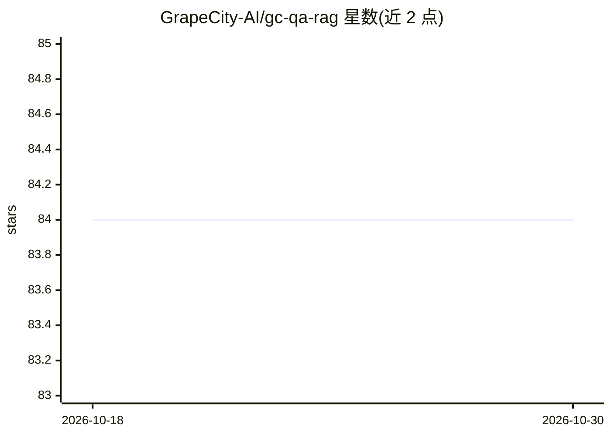

# GrapeCity-AI/gc-qa-rag

⭐ 84 · Python · MIT · 推送 2026-01-19 · [GitHub](https://github.com/GrapeCity-AI/gc-qa-rag) · [官网](https://grapecity-ai.github.io/gc-qa-rag/) · 组织维护 · 中文 README

**基于 QA 预生成的企业级 RAG 问答系统，面向文档知识库**

企业级检索增强生成（RAG）解决方案：通过高级 QA 预生成技术将 PDF、Word、Markdown 等非结构化文档转化为问答知识库，替代传统文本切片。对短文档按句子数控制 QA 生成数量，对长文档采用两阶段记忆-聚焦机制；同时生成摘要、扩充答案与同义问法三种衍生数据存入向量库。系统分 ETL 构建层、检索层（问题改写/混合检索/RRF 排序）与生成层（LLM 多轮对话）。提供完整前后端代码，支持 Docker 一键部署；需外部 LLM API 与嵌入模型 API（目前仅支持 text-embedding-v4）。已在葡萄城多条产品线业务中落地。

## 筛选速览

| 维度 | 判定 | 备注 |
|---|---|---|
| AI 角色 | `ai-native` | 本体是模型或模型工具 |
| 许可风险 | `permissive` | MIT |
| 部署形态 | `self-host` | docker 或自建部署 |
| 模型依赖 | — | README 未给出锁定关系 |
| 硬件要求 | — | 无带数字的原话,不猜 |
| 安装摩擦 | `low` | 无编译、无系统依赖或容器化 |
| 成熟度 | — | 结构信号不足 |

## 能力要点

- 高级 QA 预生成：短文档句子级控制、长文档两阶段记忆-聚焦提取
- QA 之外派生摘要、扩充答案、同义问法三类数据入向量库
- ETL→检索（问题改写/混合检索/RRF）→生成的三层架构，含 ETL 管理后台与问答前端
- 提供 Docker 一键部署（Docker Hub 镜像或本地构建）

## 适用场景

- 把企业产品文档、社区帖子构建成智能问答知识库
- 在自有文档数据上快速部署一套带前后端的 RAG 系统
- 升级传统搜索为基于 QA 对的精准检索问答

## 场景标签

`RAG` `文档问答` · 领域:知识与检索

## 证据(README 行号)

> L9: GC-QA-RAG is an **enterprise-grade Retrieval-Augmented Generation (RAG) system**. Through our innovative **Advanced 
> L25: - 🚀 **开箱即用的解决方案**：提供从知识库构建（ETL）、后端服务到前端界面的完整代码，并支持 Docker 一键部署，助力开发者快速搭建自己的高质量 RAG 系统。
> L103: 2. **访问 RAG 问答主页**: `http://localhost:80`

## 星数曲线

2026-10-18 84 → 2026-10-30 84（+0）

---
*卡片 v1 · prompt 1.4 · 生成 2026-10-24 · 置信度 high · 依据 README sha `9d4fd2c8d7f8` · [字段定义](../../DATASET.md)*
