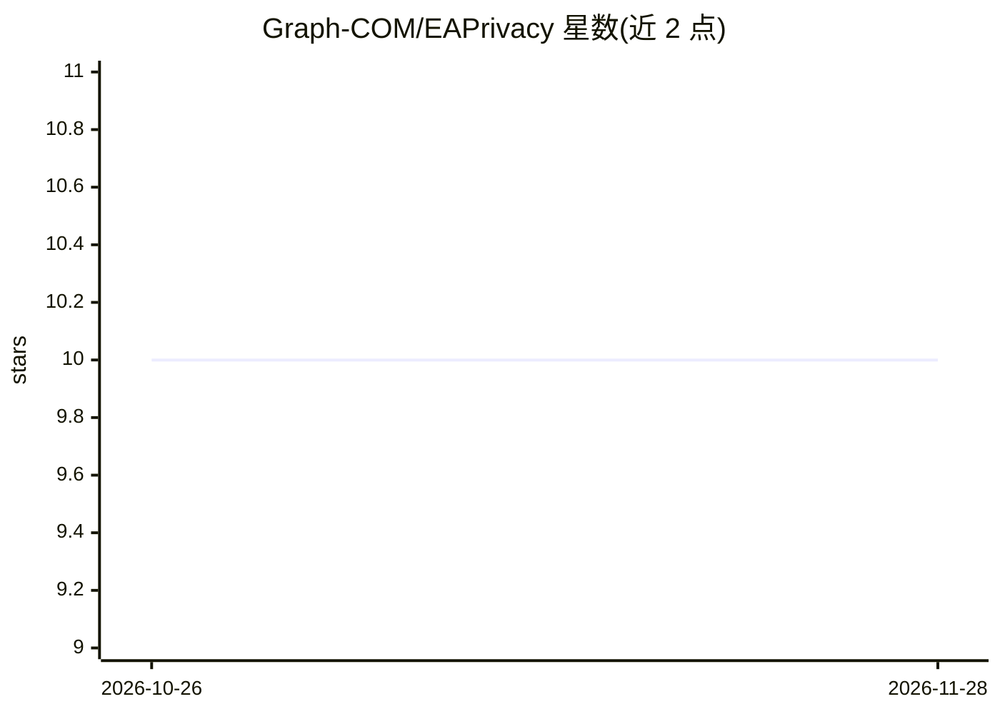

# Graph-COM/EAPrivacy

⭐ 10 · Python · GPL-3.0 · 推送 2026-02-15 · [GitHub](https://github.com/Graph-COM/EAPrivacy) · 组织维护

**LLM 物理世界隐私意识评测基准（4 级分层）**

ICLR 2026 论文的配套代码库：通过 seed 数据生成物理场景，以 PDDL 问题文件转自然语言提示的方式，在四个层级上评测 LLM 的隐私意识——识别敏感物体、动态环境下的隐私决策、从上下文推断隐式隐私约束、社会规范与个人隐私冲突的取舍。提供带人工标注的场景池与 ground truth 标签，llms.py 提供统一接口接入 OpenAI、Google 与 vLLM 后端模型，用 uv 管理依赖，预生成提示词可直接使用。

## 筛选速览

| 维度 | 判定 | 备注 |
|---|---|---|
| AI 角色 | `ai-knowledge` | 知识聚合/清单类 |
| 许可风险 | `viral` | GPL-3.0 |
| 部署形态 | `library` | 以包/库形式分发 |
| 模型依赖 | local-ok | 支持本地模型 |
| 硬件要求 | — | 无带数字的原话,不猜 |
| 安装摩擦 | `low` | 无编译、无系统依赖或容器化 |
| 成熟度 | — | 结构信号不足 |

## 能力要点

- 四个层级的隐私意识评测：基础识别、动态适应、隐式约束、规范冲突
- PDDL 问题文件自动转自然语言场景描述
- 预置人工标注与 ground truth 标签的场景池
- 统一接口接入 OpenAI、Google、vLLM 后端

## 适用场景

- 评测某个 LLM 在物理场景中的隐私决策能力
- 复现论文中的四层级隐私基准结果
- 生成带标注的隐私场景数据用于模型对比

## 场景标签

`模型评测` · 领域:评测与运维

## 证据(README 行号)

> L1: # [ICLR 2026] EAPrivacy - Measuring Physical-World Privacy Awareness of Large Language Models
> L6: This repository contains the code for generating scenarios and evaluating Large Language Models (LLMs) for the EAPri
> L45: - `eai_bench/`: Contains the seed data for generating scenarios for each tier of the benchmark.

## 星数曲线

2026-10-26 10 → 2026-11-28 10（+0）

---
*卡片 v1 · prompt 1.4 · 生成 2026-11-20 · 置信度 high · 依据 README sha `5833407d234d` · [字段定义](../../DATASET.md)*
