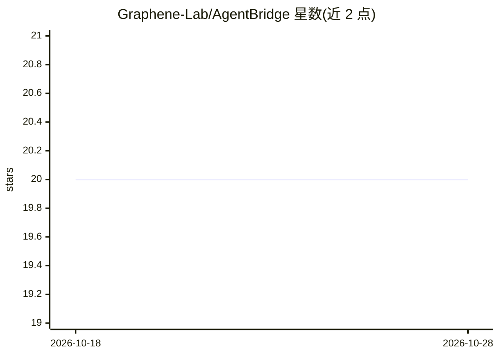

# Graphene-Lab/AgentBridge

⭐ 20 · C# · AGPL-3.0 · 推送 2026-10-27 · [GitHub](https://github.com/Graphene-Lab/AgentBridge) · [官网](https://graphenelab.it/AgentBridge/) · 组织维护

**自托管 AI 办公助理服务器：终端 TUI + OpenAI 协议 API**

自托管单进程服务器，内置自有 agent 引擎（AIOrchestrator/AgentHarness），通过全屏终端 TUI 与兼容 OpenAI 协议的 HTTP API（POST /v1/chat/completions）两种界面驱动同一批 agent。工具能力以编译的 .NET 程序集插件形式从 Tools/ 目录加载；提供 WebTool 浏览器操作、SpreadsheetTool、FreeCADTool 参数化 CAD 插件、Kokoro TTS 语音与播客生成、OfficeManager 可视化 agent 办公界面。知识库为本地磁盘文件夹，支持索引 TB 级数据，文件不离开本机；不提供代码执行类功能，文件操作带版本化可回滚。面向企业与个人用户，运行于自有硬件，发布 AGPL v3。

## 筛选速览

| 维度 | 判定 | 备注 |
|---|---|---|
| AI 角色 | `ai-native` | 本体是模型或模型工具 |
| 许可风险 | `viral` | AGPL-3.0 |
| 部署形态 | `desktop` | 安装包/桌面程序 |
| 模型依赖 | local-ok | 支持本地模型 |
| 硬件要求 | `cpu-ok` | |
| 安装摩擦 | `medium` | 含编译或系统依赖之一 |
| 成熟度 | — | 结构信号不足 |

## 能力要点

- OpenAI 兼容 API 与终端 TUI 共享同一进程同一会话的 agent
- 工具为编译 .NET 程序集插件（Universal Tool System），无解释器与远程工具服务器
- WebTool 在真实浏览器中执行登录、填表、发布等任务
- 内置 Kokoro TTS，可端到端生成播客 MP3 与 RSS；FreeCADTool 生成参数化 3D 模型

## 适用场景

- 让 agent 生成发票、合同、Excel 表格与 PDF 分析报告等办公文档
- 通过 OpenAI 兼容客户端让脚本与机器人调用同一 agent 团队
- 在自有硬件上搭建可索引本地知识库的私有 AI 助理
- 自动执行浏览器中的表单填写与社交发布任务

## 场景标签

`AI 助手` `语音合成` `浏览器自动化` · 领域:效率与自动化

## 证据(README 行号)

> L6: AgentBridge is a self-hosted server that runs its own AI agents behind two primary interfaces in a single process: a
> L157: Agent Bridge is a tool that allows you to connect to your preferred AI, transforming it into your personal assista
> L159: Agent Bridge positions itself as an enterprise-grade AI automation platform for businesses or private individuals 

## 星数曲线

2026-10-18 20 → 2026-10-28 20（+0）

---
*卡片 v1 · prompt 1.4 · 生成 2026-10-28 · 置信度 mid · 依据 README sha `ccf4e0550f9e` · [字段定义](../../DATASET.md)*
