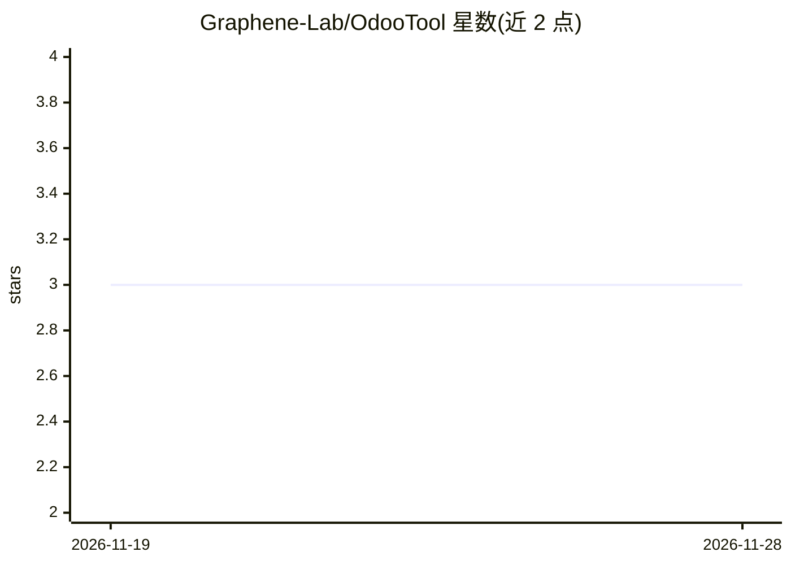

# Graphene-Lab/OdooTool

⭐ 3 · C# · NOASSERTION · 推送 2026-11-20 · [GitHub](https://github.com/Graphene-Lab/OdooTool) · [官网](https://www.odoo.com/) · 组织维护

**让 LLM agent 通过 JSON-2 API 读写自托管 Odoo ERP 数据的工具插件**

OdooTool 是运行在 AgentBridge 宿主内的插件，将 agent 的决策转换为对 Odoo Community JSON-2 外部 API 的类型化 C# 调用，覆盖客户、产品、销售订单、发票、库存等数据的搜索、读取、创建、更新、删除与聚合。提供 13 个工具方法，每次调用以配置的 Odoo 用户身份执行，访问权与字段级权限仍由 Odoo 施加。配套一键安装脚本（Windows/Linux）自动装好 PostgreSQL、Odoo 20 Community 与 AgentBridge；插件本身不可独立运行，iOS 不受支持。

## 筛选速览

| 维度 | 判定 | 备注 |
|---|---|---|
| AI 角色 | `ai-ecosystem` | LLM/agent 周边工具 |
| 许可风险 | `none` | NOASSERTION |
| 部署形态 | `desktop` | 安装包/桌面程序 |
| 模型依赖 | local-ok | 支持本地模型 |
| 硬件要求 | — | 无带数字的原话,不猜 |
| 安装摩擦 | `low` | 无编译、无系统依赖或容器化 |
| 成熟度 | — | 结构信号不足 |

## 能力要点

- 13 个类型化工具方法：模型/字段发现、CRUD、call_method、分组聚合、菜单、连接检查
- 一键安装脚本自动部署 PostgreSQL + Odoo 20 Community + AgentBridge + 插件
- 调用以配置的 Odoo 用户身份执行，访问权、记录规则与字段权限仍然生效
- 不直接写数据库，CRUD 之外的 workflow 动作通过 call_method 调用

## 适用场景

- 用自然语言在自托管 Odoo 里建报价单、查逾期发票等日常操作
- 为已有 Odoo Community/Enterprise 实例接入 LLM agent 自动化
- 本地私有化部署 ERP 且数据不出本机的自动化方案

## 场景标签

`工作流自动化` · 领域:效率与自动化

## 证据(README 行号)

> L31: |**An AI agent / AI assistant for Odoo ERP**|13 typed tool methods: model and field discovery, search, read, create
> L33: |**An alternative to an "Odoo MCP server"**|Same idea, less moving parts: instead of generating JSON-RPC scripts at
> L155: 2. **AgentBridge** (or AIOffice) — the host that runs the agent and the chat front-end. OdooTool is

## 星数曲线

2026-11-19 3 → 2026-11-28 3（+0）

---
*卡片 v1 · prompt 1.4 · 生成 2026-11-22 · 置信度 high · 依据 README sha `c0934a1d3bff` · [字段定义](../../DATASET.md)*
