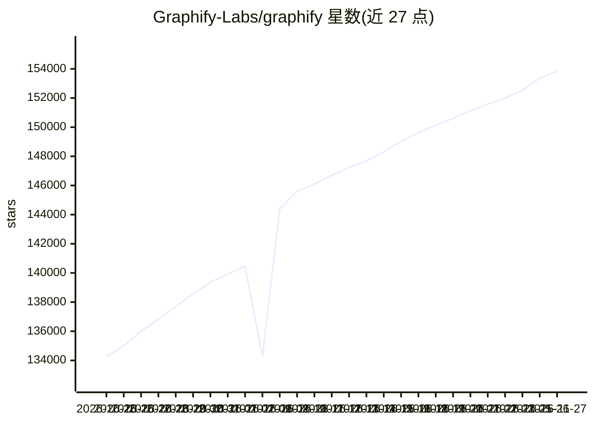

# Graphify-Labs/graphify

⭐ 153,837 · Python · Apache-2.0 · 推送 2026-11-26 · [GitHub](https://github.com/Graphify-Labs/graphify) · [官网](graphify.com) · 组织维护

**把代码库转成可查询知识图谱的 AI 编码助手技能**

Graphify 以 CLI 加 agent skill 形式安装到 Claude Code、Cursor、Codex、Gemini CLI 等 20+ AI 编码助手中，将代码、文档、SQL、配置和 PDF 映射为可查询的知识图谱。代码经 tree-sitter AST 本地确定性解析（无 LLM、不外发数据），文档与媒体才调用助手模型或配置的 API key；每条边带 EXTRACTED/INFERRED 置信标签，输出 graph.html/GRAPH_REPORT.md/graph.json 三个文件，支持 explain/query/path 等查询命令。

## 筛选速览

| 维度 | 判定 | 备注 |
|---|---|---|
| AI 角色 | `ai-ecosystem` | LLM/agent 周边工具 |
| 许可风险 | `permissive` | Apache-2.0 |
| 部署形态 | `library` | 以包/库形式分发 |
| 模型依赖 | — | README 未给出锁定关系 |
| 硬件要求 | — | 无带数字的原话,不猜 |
| 安装摩擦 | `low` | 无编译、无系统依赖或容器化 |
| 成熟度 | `idea` | |

## 动量与使用信号

- 维护:`active` — 距上次 push 1.6 天,年发版 100,328 位贡献者
- 涨星:近 1 天 **+566**(自 20261016 起算)
- 安装:npm 包 `skills` 月下载 23,786,800
- 平台:— · 协议:OPENAI-API / MCP / OLLAMA

## 能力要点

- tree-sitter AST 本地解析，~40 种语言的跨文件 calls/imports/inherits 链接
- 每条边带 EXTRACTED/INFERRED 置信标签，path 查询给出整体置信度
- 无嵌入、无向量存储，直接遍历图结构
- 一套安装适配 20+ 助手，支持用户级或项目级（--project）skill 注册

## 适用场景

- 加入陌生项目时让助手解释组件间如何连接
- 追踪共享组件的调用方与依赖路径
- 排查 bug 时查询端点与存储之间的路径
- 把设计注释与 ADR/RFC 关联到代码节点

## 场景标签

`知识图谱` · 领域:知识与检索

## 证据(README 行号)

> L29: Type `/graphify` in your AI coding assistant and it maps your entire project (code, docs, PDFs, images, videos) int
> L31: - **Code maps for free, fully local.** Code is parsed with tree-sitter AST: deterministic, no LLM, nothing leaves y
> L46: graphify install               # sets up Claude Code (the default)

## 星数曲线

2026-10-25 134,281 → 2026-11-27 153,837（+19,556）

---
*卡片 v1 · prompt 1.4 · 生成 2026-11-27 · 置信度 mid · 依据 README sha `3898e3173ab9` · [字段定义](../../DATASET.md)*
