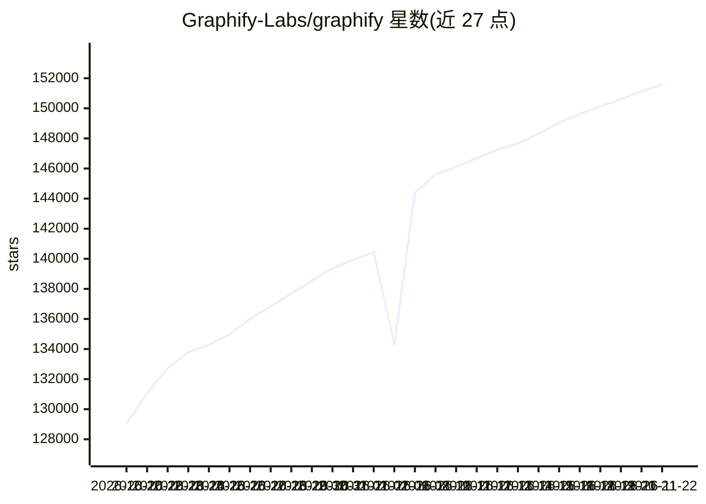

# Graphify-Labs/graphify

⭐ 151,572 · Python · Apache-2.0 · 推送 2026-11-20 · [GitHub](https://github.com/Graphify-Labs/graphify) · [官网](https://www.graphify.com) · 组织维护 · 中文 README

**把代码库连同文档/PDF 解析成可查询知识图谱，供 AI 编码助手复用上下文**

以 CLI + 助手技能（/graphify）形式安装到 Claude Code、Cursor 等 20+ 编码助手中：用 tree-sitter AST 在本地确定性解析约 40 种语言的代码，跨文件解析 calls/imports/inherits 等关系，构建无向量库、无嵌入的知识图谱，边带 EXTRACTED/INFERRED 置信标签；文档、PDF、图片与音视频经助手模型或配置的 API key 做语义处理。输出 graph.html、GRAPH_REPORT.md 与可查询的 graph.json，支持 query/path/explain 命令。需要 Python 3.11.5–3.14 与 uv 或 pipx。提供 Graphify Cloud 托管服务用于持续跨仓库图谱。

## 筛选速览

| 维度 | 判定 | 备注 |
|---|---|---|
| AI 角色 | `ai-ecosystem` | LLM/agent 周边工具 |
| 许可风险 | `permissive` | Apache-2.0 |
| 部署形态 | `library` | 以包/库形式分发 |
| 模型依赖 | locked-api |  |
| 硬件要求 | — | 无带数字的原话,不猜 |
| 安装摩擦 | `low` | 无编译、无系统依赖或容器化 |
| 成熟度 | — | 结构信号不足 |

## 动量与使用信号

- 维护:`active` — 距上次 push 1.6 天,年发版 100,328 位贡献者
- 涨星:近 1 天 **+566**(自 20261016 起算)
- 安装:npm 包 `skills` 月下载 23,786,800
- 平台:— · 协议:OPENAI-API / MCP / OLLAMA

## 能力要点

- 本地 tree-sitter AST 解析，代码部分无 LLM、数据不出本机
- 每条边带 EXTRACTED/INFERRED 置信标签
- 非向量索引：真图谱遍历，支持 query/path/explain
- 一个安装适配 20+ 编码助手（macOS/Linux/Windows）

## 适用场景

- 加入不熟悉的项目时让助手解释各组件如何连接
- 修改共享组件前追踪调用方与依赖
- 排查 bug 时查询端点与存储之间的路径
- 给编码 agent 提供跨会话可复用的项目上下文

## 场景标签

`知识图谱` `文档解析` · 领域:知识与检索

## 证据(README 行号)

> L26: Type `/graphify` in your AI coding assistant and it maps your entire project (code, docs, PDFs, images, videos) int
> L99: |**Cross-file links**|`calls` / `imports` / `inherits` / `mixes_in` resolved across ~40 languages via tree-sitter A
> L186: Then run `graphify install` once. It detects which assistant you run and registers the skill, so there is no per-a

## 星数曲线

2026-10-20 129,050 → 2026-11-22 151,572（+22,522）

---
*卡片 v1 · prompt 1.4 · 生成 2026-11-22 · 置信度 mid · 依据 README sha `6b2b8d15da15` · [字段定义](../../DATASET.md)*
