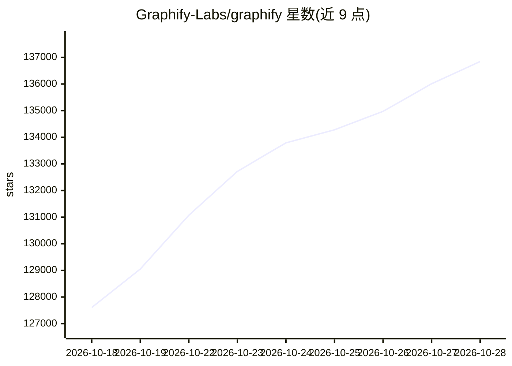

# Graphify-Labs/graphify

⭐ 136,845 · Python · Apache-2.0 · 推送 2026-10-27 · [GitHub](https://github.com/Graphify-Labs/graphify) · [官网](https://www.graphify.com) · 组织维护

**给 AI 编码助手把代码库映射成可查询知识图谱的 CLI 工具**

以 `/graphify` 技能形式注册到 Claude Code、Cursor、Codex、Gemini CLI 等 20+ 编码助手，用 tree-sitter AST 本地确定性解析代码，构建覆盖 ~40 语言的 calls/imports/inherits 跨文件知识图谱，输出 graph.html、GRAPH_REPORT.md 与 graph.json 三个文件；每条边带 EXTRACTED/INFERRED 标签，提供 query/path/explain 三类命令。文档、PDF、图像、音视频经语义 pass 也并入图。代码解析不调用 LLM、无向量索引；语义 pass 需配置模型或 API key。依赖 Python 3.10+ 与 uv/pipx。

## 筛选速览

| 维度 | 判定 | 备注 |
|---|---|---|
| AI 角色 | `ai-enhanced` | 去掉 AI 部分产品仍成立 |
| 许可风险 | `permissive` | Apache-2.0 |
| 部署形态 | `library` | 以包/库形式分发 |
| 模型依赖 | — | README 未给出锁定关系 |
| 硬件要求 | — | 无带数字的原话,不猜 |
| 安装摩擦 | `low` | 无编译、无系统依赖或容器化 |
| 成熟度 | — | 结构信号不足 |

## 动量与使用信号

- 维护:`active` — 距上次 push 1.6 天,年发版 100,328 位贡献者
- 涨星:近 1 天 **+566**(自 20261016 起算)
- 安装:npm 包 `skills` 月下载 23,786,800
- 平台:— · 协议:OPENAI-API / MCP / OLLAMA

## 能力要点

- tree-sitter AST 本地解析 ~40 语言，代码解析零 LLM 调用、数据不出本机
- 每条边带 EXTRACTED/INFERRED 置信标签
- 无嵌入与向量库，图遍历支持 query/path/explain
- 一条命令注册到 Claude Code、Cursor、Codex 等 20+ 平台

## 适用场景

- 代替 grep 在大型代码库中追问概念间关联与调用路径
- 用图谱查看新项目的核心概念（god nodes/社区划分）
- 把文档注释、ADR/RFC 与 PDF 等材料并入代码图谱统一检索

## 场景标签

`知识图谱` · 领域:知识与检索

## 证据(README 行号)

> L22: Type `/graphify` in your AI coding assistant and it maps your entire project (code, docs, PDFs, images, videos) int
> L24: - **Code maps for free, fully local.** Code is parsed with tree-sitter AST: deterministic, no LLM, nothing leaves y
> L61: **One install, any assistant, any OS.** Claude Code, Cursor, Codex, Gemini CLI, GitHub Copilot, and 20+ more, on ma

## 星数曲线

2026-10-18 127,605 → 2026-10-28 136,845（+9,240）

---
*卡片 v1 · prompt 1.4 · 生成 2026-10-18 · 置信度 mid · 依据 README sha `dd6bda435f4b` · [字段定义](../../DATASET.md)*
