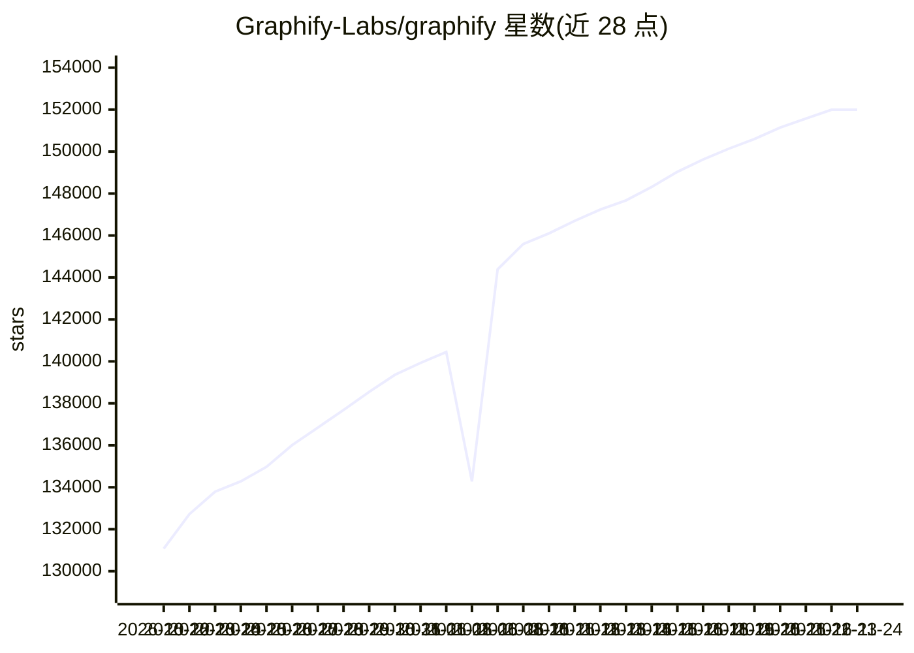

# Graphify-Labs/graphify

⭐ 152,546 · Python · Apache-2.0 · 推送 2026-11-23 · [GitHub](https://github.com/Graphify-Labs/graphify) · [官网](graphify.com) · 组织维护

**给开发者把代码库变成可查询知识图谱的 agent 技能工具**

提供 CLI 与 `/graphify` 技能，接入 Claude Code、Cursor、Codex、Gemini CLI 等 20+ AI 编码助手，把代码、文档、PDF、图片等映射为知识图谱（graph.html / GRAPH_REPORT.md / graph.json 三个产物），支持 explain/query/path 查询。代码解析用 tree-sitter AST 本地确定性完成，不调用 LLM；文档与媒体的语义环节需配置助手模型或 API key。每条边带 EXTRACTED/INFERRED 置信标签。跨约 40 种语言解析。基于 Python 3.11.5–3.14 运行，另提供 Graphify Cloud 托管服务。

## 筛选速览

| 维度 | 判定 | 备注 |
|---|---|---|
| AI 角色 | `ai-ecosystem` | LLM/agent 周边工具 |
| 许可风险 | `permissive` | Apache-2.0 |
| 部署形态 | `library` | 以包/库形式分发 |
| 模型依赖 | — | README 未给出锁定关系 |
| 硬件要求 | — | 无带数字的原话,不猜 |
| 安装摩擦 | `low` | 无编译、无系统依赖或容器化 |
| 成熟度 | — | 结构信号不足 |

## 动量与使用信号

- 维护:`active` — 距上次 push 1.6 天,年发版 100,328 位贡献者
- 涨星:近 1 天 **+566**(自 20261016 起算)
- 安装:npm 包 `skills` 月下载 23,786,800
- 平台:— · 协议:OPENAI-API / MCP / OLLAMA

## 能力要点

- tree-sitter AST 本地解析，代码图谱构建无需 LLM 与网络
- 每条边标注 EXTRACTED/INFERRED 置信标签
- 跨约 40 种语言解析 calls/imports/inherits 等关系
- 一个安装命令适配 20+ AI 编码助手平台

## 适用场景

- 加入陌生项目时快速理解组件间的连接关系
- 排查 bug 时追踪端点与存储之间的调用路径
- 给编码 agent 提供可跨会话复用的代码库上下文
- 检索设计决策注释（NOTE/WHY）与 ADR/RFC 引用

## 场景标签

`知识图谱` · 领域:知识与检索

## 证据(README 行号)

> L27: Type `/graphify` in your AI coding assistant and it maps your entire project (code, docs, PDFs, images, videos) int
> L43: uv tool install graphifyy      # install the CLI (or: pipx install graphifyy)
> L100: |**Cross-file links**|`calls` / `imports` / `inherits` / `mixes_in` resolved across ~40 languages via tree-sitter 

## 星数曲线

2026-10-22 131,072 → 2026-11-24 151,994（+20,922）

---
*卡片 v1 · prompt 1.4 · 生成 2026-11-24 · 置信度 low · 依据 README sha `4a6d8a075e9c` · [字段定义](../../DATASET.md)*
