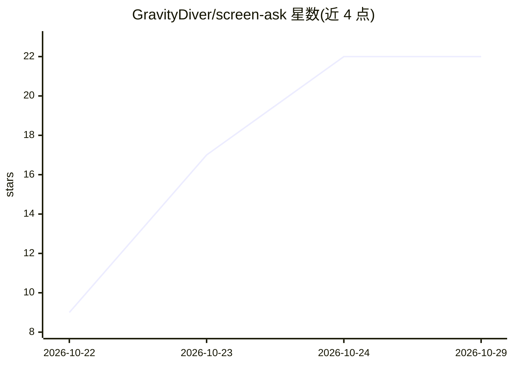

# GravityDiver/screen-ask

⭐ 22 · C# · MIT · 推送 2026-10-18 · [GitHub](https://github.com/GravityDiver/screen-ask) · 个人维护

**Windows 离线截屏问答工具：框选区域，本地 OCR 与本地 LLM 作答**

面向 Windows 10/11 用户的屏幕提问工具：快捷键框选屏幕区域，经 Windows OCR 引擎或内置 ONNX 模型提取文字，发送到本机 localhost 上的 llama.cpp 服务器，由本地 LLM 生成解释、翻译、摘要或表格提取的回答，结果回车即入剪贴板。附带最近二十条捕获历史。以约 100 MB 自包含便携 exe 分发（含 SHA-256 校验），也可用 .NET 8 SDK 从源码构建。需用户自行运行本地 LLM 服务器。

## 筛选速览

| 维度 | 判定 | 备注 |
|---|---|---|
| AI 角色 | `ai-native` | 本体是模型或模型工具 |
| 许可风险 | `permissive` | MIT |
| 部署形态 | `None` |  |
| 模型依赖 | — | README 未给出锁定关系 |
| 硬件要求 | — | 无带数字的原话,不猜 |
| 安装摩擦 | `medium` | 含编译或系统依赖之一 |
| 成熟度 | — | 结构信号不足 |

## 能力要点

- 快捷键框选区域作为提问上下文
- Windows OCR 引擎或内置 ONNX 模型本地识别
- 连接 localhost 上任意 llama.cpp 服务器本地作答
- 约 100 MB 自包含便携 exe，无需安装、离线运行

## 适用场景

- 对屏幕上的文字让 AI 解释、翻译、摘要或提取成表
- 在 NDA/隐私要求下不把截图上传云端地提问
- 离线环境下快速查询屏幕内容

## 场景标签

`OCR` · 领域:感知与多模态

## 证据(README 行号)

> L3: 👁️ Free, open-source ask-your-screen tool for Windows — capture a region, OCR and local LLM answer offline. 100 MB p
> L13: - ✅ **Local LLM answers** — connects to any llama.cpp server on localhost and asks about the captured content

## 星数曲线

2026-10-22 9 → 2026-10-29 22（+13）

---
*卡片 v1 · prompt 1.4 · 生成 2026-10-27 · 置信度 high · 依据 README sha `5fadd0d550ee` · [字段定义](../../DATASET.md)*
