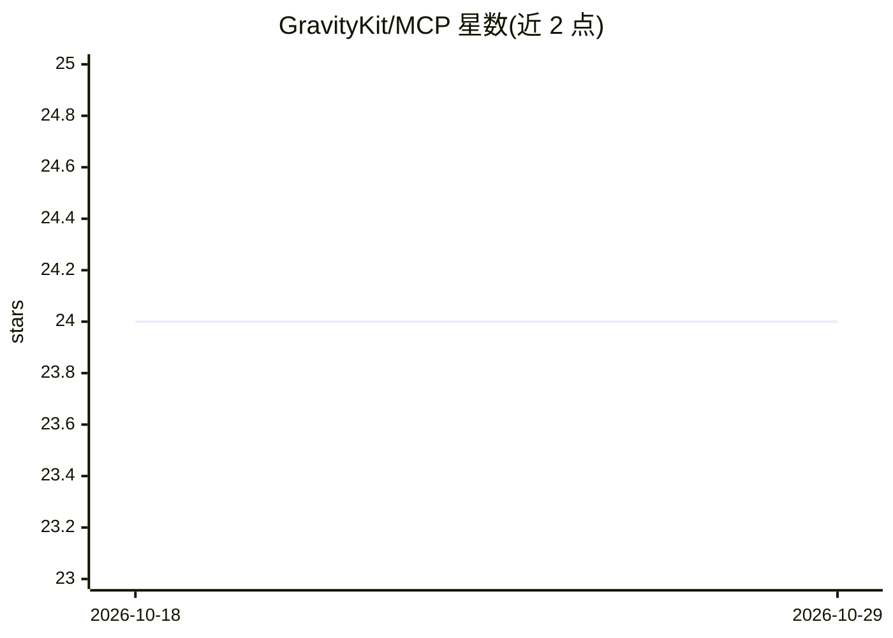

# GravityKit/MCP

⭐ 24 · JavaScript · MIT · 推送 2026-10-14 · [GitHub](https://github.com/GravityKit/MCP) · [官网](https://www.gravitykit.com/mcp/) · 组织维护

**MCP 服务器：让 AI 客户端操作 WordPress Gravity Forms 表单**

由 GravityKit 构建的 Model Context Protocol 服务器，通过 WordPress REST API 让任意 MCP 兼容客户端（如 Claude Desktop）管理 Gravity Forms 的表单、条目、字段、提交流程、通知与 MailChimp/Stripe/PayPal 等插件 feed，提供 26 个静态工具；站点启用 GravityKit Foundation 时还会从 Abilities 目录动态生成各产品前缀工具（gv_*/gb_*/gmig_*/mergetags_*）。以 npx 按需运行，需 Node.js 18+ 与 Gravity Forms 2.5+，认证用应用密码或 GF 密钥对，删除类工具默认禁用需显式开启。

## 筛选速览

| 维度 | 判定 | 备注 |
|---|---|---|
| AI 角色 | `ai-ecosystem` | LLM/agent 周边工具 |
| 许可风险 | `permissive` | MIT |
| 部署形态 | `library` | 以包/库形式分发 |
| 模型依赖 | — | README 未给出锁定关系 |
| 硬件要求 | — | 无带数字的原话,不猜 |
| 安装摩擦 | `low` | 无编译、无系统依赖或容器化 |
| 成熟度 | — | 结构信号不足 |

## 能力要点

- 26 个 Gravity Forms 静态工具覆盖表单/条目/字段/提交/feed/通知
- 从 GravityKit Foundation Abilities 目录动态生成产品工具
- 支持应用密码与 GF 密钥对两种认证，自动选择传输方式
- 删除/覆盖类工具默认禁用，需通过环境变量显式允许

## 适用场景

- 在 Claude Desktop 等 MCP 客户端中直接管理 WordPress 表单与条目
- 通过对话完成表单创建、字段调整与数据提交
- 把 Gravity Forms 迁移、视图配置等 GravityKit 产品操作接入 AI 客户端

## 场景标签

`工作流自动化` · 领域:效率与自动化

## 证据(README 行号)

> L3: A Model Context Protocol (MCP) server for Gravity Forms and GravityKit. Interact with your WordPress forms, feeds, a
> L64: Two planes: **Gravity Forms** (`gf_*`) — 26 static tools, listed whenever Gravity Forms credentials are valid — and

## 星数曲线

2026-10-18 24 → 2026-10-29 24（+0）

---
*卡片 v1 · prompt 1.4 · 生成 2026-10-27 · 置信度 high · 依据 README sha `fc41de5e601a` · [字段定义](../../DATASET.md)*
