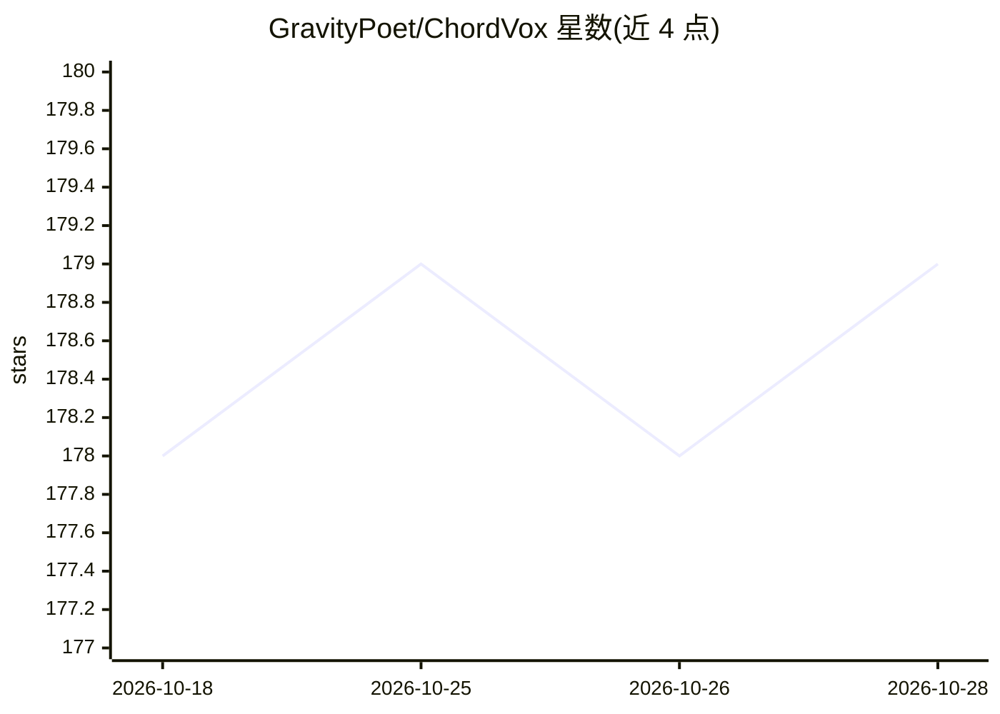

# GravityPoet/ChordVox

⭐ 180 · TypeScript · AGPL-3.0 · 推送 2026-10-20 · [GitHub](https://github.com/GravityPoet/ChordVox) · [官网](https://chordvox.com) · 个人维护 · 中文 README

**离线本地语音输入工具：说话即转文字并粘贴到光标处**

面向 macOS/Windows/Linux 用户的桌面语音输入法：按住快捷键说话，内置 whisper.cpp、NVIDIA Parakeet、SenseVoice 引擎在本地 CPU/GPU 上完成离线转录，经可选的 AI 润色管线（OpenAI/Claude/Gemini/Groq/DeepSeek 或捆绑 llama.cpp 运行本地 GGUF 模型，BYOK）整理后直接粘贴到光标位置，支持多快捷键工作流、自定义词典与模型缓存管理。提供 dmg/exe/AppImage/deb/rpm 安装包，AGPL-3.0 开源，另有可选 Pro 功能；macOS 构建未做 Apple 公证，首次启动需手动放行。

## 筛选速览

| 维度 | 判定 | 备注 |
|---|---|---|
| AI 角色 | `ai-native` | 本体是模型或模型工具 |
| 许可风险 | `viral` | AGPL-3.0 |
| 部署形态 | `desktop` | 安装包/桌面程序 |
| 模型依赖 | local-ok | 支持本地模型 |
| 硬件要求 | — | 无带数字的原话,不猜 |
| 安装摩擦 | `medium` | 含编译或系统依赖之一 |
| 成熟度 | — | 结构信号不足 |

## 能力要点

- 内置 whisper.cpp / Parakeet / SenseVoice 引擎，完全离线转录，无需 Python 运行时
- 转录结果经 AI 润色后直接粘贴至光标处，零窗口切换
- 支持 BYOK 接入 OpenAI/Claude/Gemini/Groq/DeepSeek，或经捆绑 llama.cpp 运行本地 GGUF 模型
- 多快捷键工作流：不同按键绑定独立的转录与推理模型组合

## 适用场景

- 日常聊天、搜索、写日记时用说话代替打字
- 工程师不中断思路口述 PR 描述、代码注释与提交信息
- 法律/医疗/金融等对隐私敏感的场景做 100% 本地语音处理
- 写作者以自然语速捕捉初稿与头脑风暴

## 场景标签

`语音识别` · 领域:感知与多模态

## 证据(README 行号)

> L47: |Voice clips and proprietary text uploaded to third-party clouds|100% offline local transcription (`whisper.cpp`, `
> L62:  - **Result:** Core transcription runs completely offline on your CPU/GPU. No audio ever touches the network. Bring

## 星数曲线

2026-10-18 178 → 2026-10-28 179（+1）

---
*卡片 v1 · prompt 1.4 · 生成 2026-10-22 · 置信度 high · 依据 README sha `a46f6cfe0edd` · [字段定义](../../DATASET.md)*
