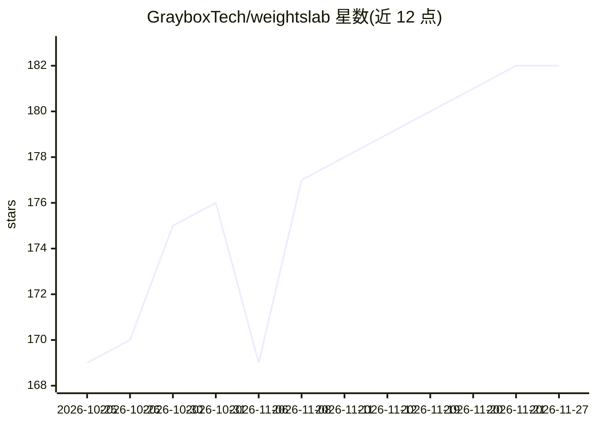

# GrayboxTech/weightslab

⭐ 182 · Python · NOASSERTION · 推送 2026-11-25 · [GitHub](https://github.com/GrayboxTech/weightslab) · [官网](https://www.graybx.com) · 组织维护

**ML 团队实时监控并中途干预 PyTorch 训练的平台**

WeightsLab 通过包装参数、模型、优化器与数据集接入现有 PyTorch 训练循环，提供浏览器 UI，可在不重启训练的情况下按样本损失排序定位错标/类别不平衡/异常样本，实时改标、删样本或调学习率后从同一 checkpoint 继续。以 pip/uv 安装，CLI 启动本地 Studio UI，支持分类/分割/检测/聚类示例，并内置两个 agent 入口（SDK 数据操作 agent 与 OpenCode 本地 agent）。许可为非商业免费、商业需付费授权。

## 筛选速览

| 维度 | 判定 | 备注 |
|---|---|---|
| AI 角色 | `ai-ecosystem` | LLM/agent 周边工具 |
| 许可风险 | `none` | NOASSERTION |
| 部署形态 | `library` | 以包/库形式分发 |
| 模型依赖 | — | README 未给出锁定关系 |
| 硬件要求 | — | 无带数字的原话,不猜 |
| 安装摩擦 | `medium` | 含编译或系统依赖之一 |
| 成熟度 | — | 结构信号不足 |

## 能力要点

- 暂停训练、按损失信号排查错标与异常样本，无需重启
- 训练中途改标/删样本/调超参后从同一 checkpoint 恢复
- 支持图像、视频、文本与 LiDAR 数据
- 内置 SDK agent 与 OpenCode 本地 agent，可指向本地模型

## 适用场景

- 训练中发现脏数据时暂停并现场修复后继续训练
- 排查错标、类别不平衡与异常样本
- 通过逐样本损失轨迹定位模型退化的位置

## 场景标签

`MLOps` · 领域:训练与推理

## 证据(README 行号)

> L26: WeightsLab hooks into your existing PyTorch training loop and exposes a live UI where you can inspect per-sample si
> L131: WeightsLab ships two distinct agent surfaces: the backend SDK agent for data-manipulation
> L158: WeightsLab is free for noncommercial use. Commercial use needs a paid licence.

## 星数曲线

2026-10-25 169 → 2026-11-27 182（+13）

---
*卡片 v1 · prompt 1.4 · 生成 2026-11-26 · 置信度 high · 依据 README sha `678584747441` · [字段定义](../../DATASET.md)*
