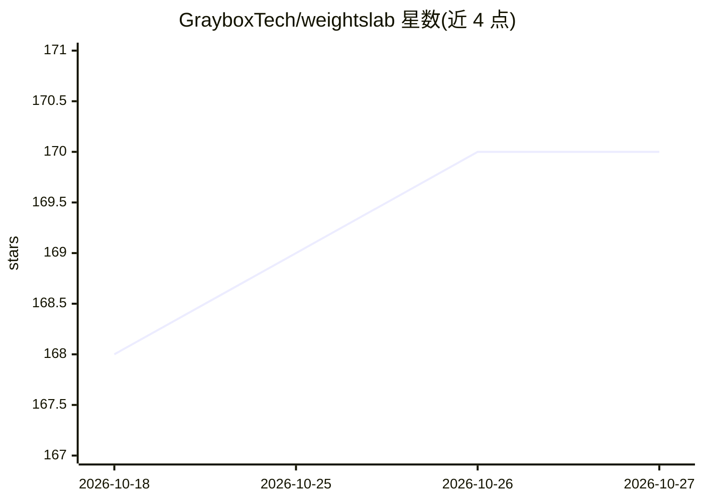

# GrayboxTech/weightslab

⭐ 170 · Python · Apache-2.0 · 推送 2026-10-23 · [GitHub](https://github.com/GrayboxTech/weightslab) · [官网](https://www.graybx.com) · 组织维护

**面向 ML 团队的训练监控与数据治理平台**

接入现有 PyTorch 训练循环的监控平台：暴露实时 UI 供查看逐样本信号、按 loss 排序发现误标与离群样本，支持训练中暂停、在线重标注或丢弃样本并从同一 checkpoint 恢复训练；可监控并从 UI 修改超参、模型状态与学习率。覆盖图像、视频、文本与 LiDAR 数据。另提供两个 agent 表面：后端 SDK 数据操作 agent 与 OpenCode 驱动的本地 agent（可重启训练、编辑代码、跑 /loop 周期监控）。以 pip 安装，CLI 启动 UI。

## 筛选速览

| 维度 | 判定 | 备注 |
|---|---|---|
| AI 角色 | `ai-ecosystem` | LLM/agent 周边工具 |
| 许可风险 | `permissive` | Apache-2.0 |
| 部署形态 | `library` | 以包/库形式分发 |
| 模型依赖 | — | README 未给出锁定关系 |
| 硬件要求 | — | 无带数字的原话,不猜 |
| 安装摩擦 | `low` | 无编译、无系统依赖或容器化 |
| 成熟度 | — | 结构信号不足 |

## 能力要点

- 训练中暂停并在不重启的情况下在线修改数据集
- 逐样本 loss 信号排序，发现误标、类不平衡与离群样本
- 从 UI 监控并修改超参、模型与优化器状态
- 支持图像、视频、文本与 LiDAR 数据的策展

## 适用场景

- 训练中途暂停并清理坏数据后从同一 checkpoint 恢复
- 按 loss 排序快速定位误标与离群样本
- 分析逐样本 loss 轨迹定位模型退化
- 通过对话 agent 操作与监控训练任务

## 场景标签

`MLOps` · 领域:训练与推理

## 证据(README 行号)

> L26: WeightsLab hooks into your existing PyTorch training loop and exposes a live UI where you can inspect per-sample si
> L94:    parameters      = wl.watch_or_edit(parameters, flag='hp',     ...) # ← WeightsLab monitors your parameters and l

## 星数曲线

2026-10-18 168 → 2026-10-27 170（+2）

---
*卡片 v1 · prompt 1.4 · 生成 2026-10-22 · 置信度 high · 依据 README sha `1e201efcf406` · [字段定义](../../DATASET.md)*
