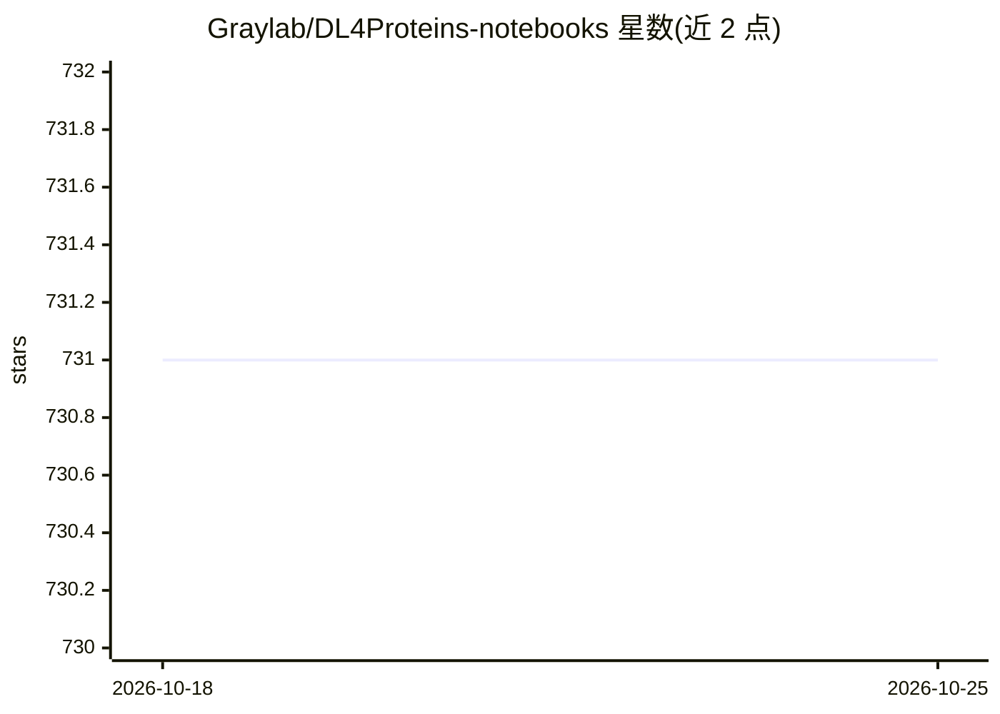

# Graylab/DL4Proteins-notebooks

⭐ 731 · Jupyter Notebook · MIT · 推送 2026-04-17 · [GitHub](https://github.com/Graylab/DL4Proteins-notebooks) · 组织维护

**面向科研与教学的蛋白质深度学习 Jupyter/Colab 笔记本教程集**

Johns Hopkins Gray 实验室维护的 DL4Proteins 工作坊教程：以 10 章 Jupyter 笔记本（可在 Google Colaboratory 运行）介绍蛋白质设计与结构预测所用深度学习方法，从 NumPy/PyTorch 神经网络基础、CNN、语言模型，到 AlphaFold、图神经网络、扩散模型，以及 RFDiffusion→ProteinMPNN→AlphaFold 的完整流程。面向研究人员、教师与学生，配有配套 preprint 阐述教学框架。仓库持续更新并吸纳反馈。

## 筛选速览

| 维度 | 判定 | 备注 |
|---|---|---|
| AI 角色 | `ai-knowledge` | 知识聚合/清单类 |
| 许可风险 | `permissive` | MIT |
| 部署形态 | `None` |  |
| 模型依赖 | — | README 未给出锁定关系 |
| 硬件要求 | — | 无带数字的原话,不猜 |
| 安装摩擦 | `low` | 无编译、无系统依赖或容器化 |
| 成熟度 | — | 结构信号不足 |

## 能力要点

- 10 章笔记本地覆盖神经网络基础到 AlphaFold/RFDiffusion/ProteinMPNN
- 全部笔记本可在 Google Colaboratory 中运行
- 配套 preprint 描述教学动机、学习目标与各笔记本的深度学习原理
- 流程示例：RFDiffusion 生成 → ProteinMPNN 设计 → AlphaFold 验证

## 适用场景

- 系统学习蛋白质设计与结构预测中的深度学习方法
- 教学场景中提供可动手运行的课堂材料
- 了解从扩散模型到序列设计再到结构验证的完整计算流程

## 场景标签

`教程课程` `科研工具` · 领域:学习与行业

## 证据(README 行号)

> L9: The goal of the DL4Proteins notebook series is to democratize deep learning for protein design and prediction, arriv
> L16: The Jupyter notebooks below provide an introduction to the fundamental machine learning concepts and models current

## 星数曲线

2026-10-18 731 → 2026-10-25 731（+0）

---
*卡片 v1 · prompt 1.4 · 生成 2026-10-21 · 置信度 high · 依据 README sha `4be2a9a7ddb4` · [字段定义](../../DATASET.md)*
